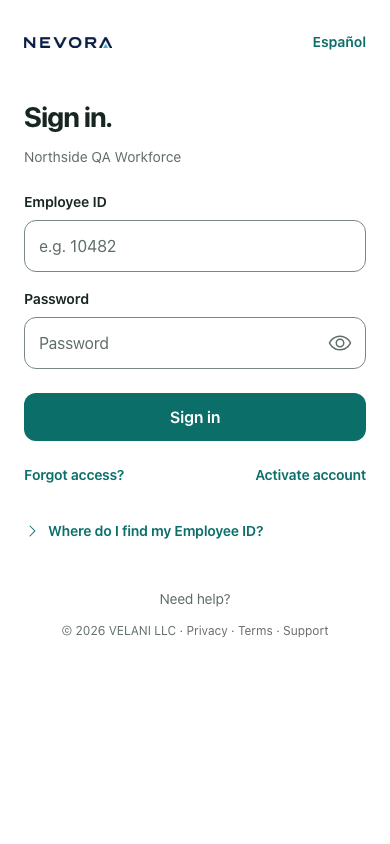
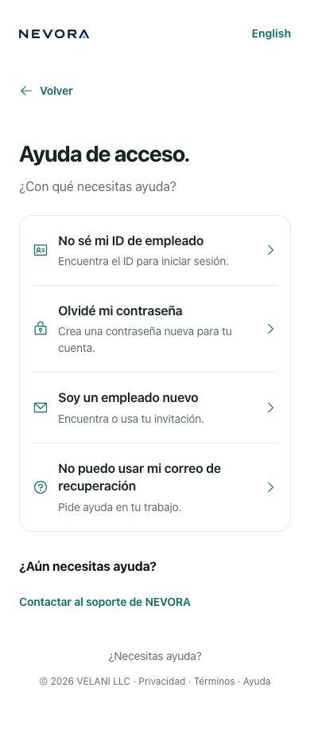

# Mobile Access integration evidence

Runtime candidate: `c61376f476b184d3374816c3d87fb0a51603bbc5`, based on `development`46e2027. Later handoff/evidence changes do not alter executable inputs.

[Verification summary](verification.json) records actual counts, limits and SHA256 hashes of the full external logs and changed runtime inputs. [Browser results](browser-results.json) records the completed three-engine run. Full owned runtime/source/build receipts and logs remain in the task-owned `work/integration-evidence` directory outside the repository. They are developer verification, not independent certification or production results.

These390px screenshots show the actual Next app using fictional local data. The development-only Next indicator is hidden for capture; application content is unaltered. Screenshot dimensions use the normal text size; overflow also passed at200%.

| Welcome | Sign in | Spanish Help |
|---|---|---|
|  |  |  |

[Review remediation](review-remediation.md) preserves the initial findings and distinguishes the author’s fixes from independent sign-off. [Handoff](../../handoffs/2026-10-26-mobile-access-onboarding-integration.md) includes rollout/rollback and remaining launch requirements.
