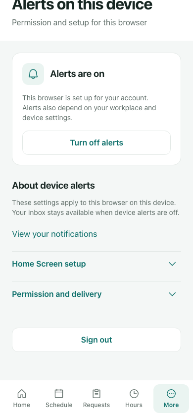
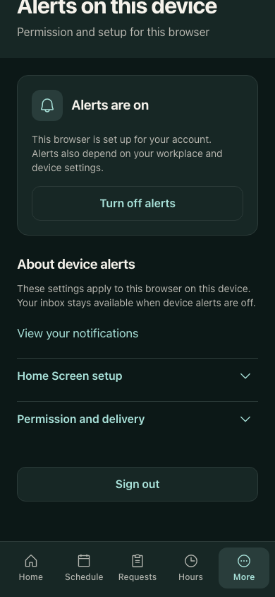

# Employee mobile Alerts — review gallery

Application `72b1c192`; final test-only verification `7ddf3771`. These are actual local React/Next views with fictional native push boundaries and canonical disposable SQL. Viewport captures preserve mobile capability. They do not certify physical OS delivery or assistive technology.

## Light and dark

## More states and interaction evidence

- [Uncertain turn-off recovery](../evidence/root/reviews/qa/affected-recovery-02/device/chromium-cleanup-pending.png)
- [Permission blocked](../evidence/root/reviews/qa/affected-recovery-02/device/chromium-permission-blocked.png)
- [WebKit native keyboard focus at 200% text](../evidence/root/reviews/qa/affected-recovery-02/device/webkit-light-text200-Turn-off-alerts.png)
- [Firefox dark genuine coarse landscape](../evidence/root/reviews/qa/affected-recovery-02/device/firefox-dark-coarse-landscape-1.png)
- [Installation guidance](../evidence/root/reviews/qa/affected-recovery-02/device/capability-gates/install.png)
- [All 45 checkpoints,63 captures,24 contrast samples and landscape geometry](../evidence/root/reviews/qa/affected-recovery-02/device/result.json)

The original full-page landscape images are retained as failed evidence. Independent static and actual-app probes proved that Chromium full-page capture disabled touch emulation in this runtime. Final mobile captures use the viewport and verify actual coarse capability, tokens, contrast and navigation clearance. See the [evidence history](../EVIDENCE_HISTORY.md) and [authored UI review](../evidence/root/reviews/ui/employee-mobile-device-alerts-clone-fidelity.md).
