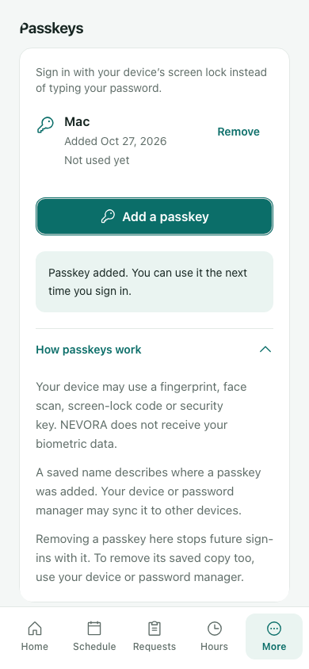
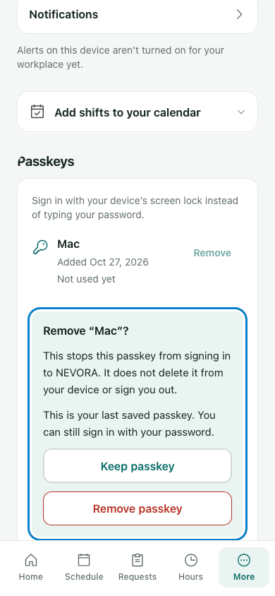

# Employee mobile passkeys — reviewed screenshots

Fictional test accounts in the actual app at candidate64063a2a. These show the implemented UI; controlled native creation exercises real canonical cryptographic verification, and does not certify a physical OS credential sheet/store.

## Saved keys and guidance

[Dark, 390 px](../evidence/root/run-09/firefox-dark-390.png) · [Empty](../evidence/root/run-09/chromium-empty.png) · [Unsupported creation with saved keys](../evidence/root/run-09/firefox-unsupported-saved.png)

## Deliberate removal

[Light200% Remove](../evidence/root/run-09/chromium-remove-light-text200.png) · [Dark200% Keep](../evidence/root/run-09/webkit-keep-dark-text200.png) · [Unknown result](../evidence/root/run-09/firefox-unknown-removal.png) · [Confirmed removal](../evidence/root/run-09/chromium-removed.png)

## Independent landscape and legacy boundary

[Employee landscape Remove](../evidence/qa-runtime/final-64063a2a-supplement/supplement/legacy-roles/employee-dark-landscape-remove.png) · [Lead landscape Keep](../evidence/qa-runtime/final-64063a2a-supplement/supplement/legacy-roles/lead-light-landscape-keep.png)

[Preserved Manager dialog](../evidence/qa-runtime/final-64063a2a-supplement/supplement/legacy-roles/manager-saved-dialog.png) · [Preserved Owner dialog](../evidence/qa-runtime/final-64063a2a-supplement/supplement/legacy-roles/owner-saved-dialog.png)

[Independent UI report](../evidence/root/reviews/ui/UI_REVIEW.md) · [Independent QA report](../evidence/root/reviews/qa/QA_REVIEW.md) · [Handoff](../HANDOFF.md)
