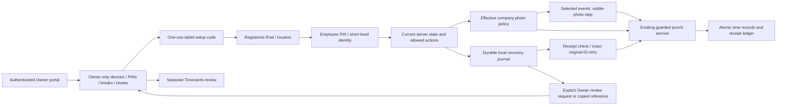

# Clocker integration map — iPad

Date: October 27, 2026. Status: source discovery and integration design complete; application implementation and physical iPad acceptance have not run in this phase.

## Intent and scope

Connect the reviewed shared-tablet Clocker interface to Nevora's real services. Jose confirmed **iPads only**, employee clocking on a shared device, and **Owner-only administration**. Jose subsequently confirmed **each company Owner controls photo enablement and the clock actions that use photos**; see [photo policy](photo-policy.md). Preserve the established teal/system-type/regular-Phosphor design, deliberate spacing, readable task hierarchy and limited choices. Retain all existing timekeeping, receipt, concurrency and privacy controls.

The next deliverable authorized in this conversation was the integration map and implementation plan. This document records the engineering recommendation; it does not claim an application release or silently approve new deployment or data-retention policy.

**Prototype:** `d7204373a53e332332600ab0ffe01052801e550f2e3ad543d4fe26402d7df257` (`outputs/clocker/index.html`). Its earlier51-case three-engine and23-domain results belong to the prototype, not this application integration.

**Application:** freshly fetched `origin/development` at `dfdcefa0edc9d02bad5edf79b2b5a9587b194eb2`. The inspection checkout stays clean/detached at `46e202786863279302026ee03a0e225c359fa55c`. Clocker route/component/service files have no diff between that checkout and the fetched revision. Direct callers were inspected from a pinned388-file text snapshot of the fetched revision. Local `development` is behind the remote and must not be used as the implementation base.

## Recommended approach

Port the presentation into the existing Next/React Clocker boundaries and retain its server engine. Keep the standalone prototype as the visual/state reference. Implement the production gaps as small explicit contracts before claiming feature parity.

A visual-only paste would lose real cookie, revision and recovery semantics. A new punch backend would duplicate an existing guarded ledger and increase risk. A native iPad rewrite adds a platform and distribution project not requested here. The recommended browser-based integration reuses the existing web architecture and requires both Safari and Home Screen web-app acceptance across iPad families. This is the proposed execution approach, not a new global Nevora design decision.

No employee surface opens administration. A request for review never records or corrects time. No analytics, replay, automatic email/SMS, remote punch, payroll calculation or paid/unpaid policy is introduced.

## Workflow-to-code map

| Reviewed workflow | Prototype source | Application source / contract | Disposition / plan task |
|---|---|---|---|
| Location and ready/setup shell | `Terminal.tsx`, `Setup.tsx` | S01–S03, S11; `/clocker/[location]`; real workspace timezone and brand | Replace presentation; preserve dynamic active-location resolution, cookies and portal-session sign-out. T3 |
| Enrollment / replacement | `DeviceForm.tsx`, `device-operations.ts` | S11–S13; strict prepare/redeem/status;10-minute one-use code; `expectedVersion` | Reuse service. Replacement already invalidates credential; refresh terminal on server denial/focus, no fake live telemetry. T3/T6 |
| PIN / privacy | `PinEntry.tsx`, `Terminal.tsx` | S04; `/api/clocker/[location]/pin`; short-lived HttpOnly identity and clear queue/epoch | Add warning,20-second partial-PIN clearing, secure same-subject continuation; preserve server clear and late-response rejection. T4 |
| Current clock and location | `Punch.tsx`, model eligibility | S05, S08–S10; `ClockView`, allowed actions, `atOtherLocation` | Reuse server eligibility/current entry rather than client roster or fixture state. T5 |
| Clock in/out and break | `Punch.tsx` | `makePunchCommand`, `postPunch`, `parseReceiptReply`; action enums and version tuple | Retain exact payloads and server timestamp. Integrate reviewed action hierarchy/cancellation/receipt. T5 |
| Break configuration | `BreakSettings.tsx` | S14, S21; `{id,expectedVersion,name,category,targetMinutes,active}` | Existing editor already preserves archived state. Restyle, keep version/audit/snapshot checks. T6 |
| Per-employee recovery | `Recovery.tsx`, `time-operations.ts` | S06–S09; v1 legacy + v2 subject keys, strict receipts, original command | Already employee-scoped. Preserve isolation; add durable transactional journal and explicit stale review. T2/T5 |
| PIN reset / device-generation change | effective stale outcome | `verificationId` changes on re-PIN; opaque recovery `subject` survives re-PIN but changes on device credential rotation | Never match by name/person fixture. Same subject may resume unsent mode after fresh state; old-generation references stay Owner-reviewable. T2/T4/T5 |
| Owner escalation / incident list | compact handoff + shared in-memory Owner list | S17/S18 only look up a supplied command UUID; local pending bytes are not available on a separate Owner device | Add bounded authenticated review-request storage/list. Copy reference remains fallback when request cannot be confirmed. T7 |
| Owner PIN list / status | `PinSettings.tsx` | S15/S16/S22; employee-specific current metadata/save; profile currently hard-codes “Set” | Add Owner-only configured/unset/inactive metadata list; reuse employee PIN route. Replace false status with actual metadata or Unavailable. T1/T6 |
| Lost PIN-save response | sample pending-save readback | Existing action returns `{ok:true,version}`; audit has no operation UUID | Add opaque operation receipt/readback; current-version change alone is not proof of that save. T6 |
| Receipt lookup / Timecards handoff | `ReceiptLookup.tsx` | S17/S18; protected ledger read with15-second freshness bound; `/app/timecards` | Keep read-only. Owner-only at page, route and final service guards; no time editor here. T1/T7 |
| Employee English/Spanish | `locale.ts` | S19 supplies Spanish secondary lines while English remains accessible name | Port complete locale selection, accessible names, validation/errors/recovery/setup; no glossary. T3–T5 |
| Owner photo policy / employee capture | New confirmed integration requirement; absent from current prototype | Historical photo branch contains company policy, per-event capture, retention and Owner review; runtime remains unbound | Selective adoption and current-proof binding; no automatic activation. T8; [photo policy](photo-policy.md) |
| Responsive / brand | frozen tokens and system type | S03/S20; scoped CSS modules; company brand overrides; existing bundled Clocker font | Apply prototype default only within Clocker; preserve configured custom brand and logo. No global portal font/token replacement. T3/T6 |

Existing schedule association, attendance/clock-monitor, Timecards, reports and payroll-export readers are sibling consumers of recorded time. Keep their contracts and integration assertions; they are not new kiosk screens and must not be removed during the visual port.

## Real wire contracts that remain authoritative

| Transport | Exact existing request shape | Required behavior |
|---|---|---|
| `POST /api/clocker/[location]/setup` | `{step:'prepare'}` / `{step:'redeem',enrollmentToken}` / `{step:'status'}` | Strict Origin/header/body/cookie gates. Read status through the browser cookie before success. Redeeming signs out only the shared tablet's portal session. |
| `POST /api/clocker/[location]/pin` | `{action:'verify',pin}` / `{action:'status'}` / `{action:'clear'}` | Preserve four-digit verification, server retry limits, identity clearing and no public employee roster. |
| `POST /api/clocker/[location]/punch` | `{operation:'state'}` / `{operation:'execute',command}` / `{operation:'receipt',commandId,verificationId}` | Exact request fields,12-second client wait, server-derived identity/location/time, strict receipt validation and immutable original UUID. |
| `PunchCommand` | `{commandId,action,verificationId,expected,breakType?}` | `expected` binds revision/timeEntry/break IDs and versions; `breakType` is `{id,version}`. No browser employee ID or timestamp. |
| Device server action | `REGISTER(name,locationId)` or `RENAME/ROTATE/REVOKE(deviceId,expectedVersion[,name])` via exact FormData | Keep current Owner/session/version assertions before and after blocking work. Secrets shown only in immediate setup result. |
| Break server action | six explicit fields shown above | Classification REST/MEAL/OTHER; reference minutes null or1–1440; no automatic end or paid/unpaid claim. |
| Existing assisted review | `POST /api/manager/clocker-recovery` with `{commandId}` plus session mutation proof/actor header | The URL currently admits scoped managers; change its actual policy to Owner-only and preserve proof/freshness checks. A new Owner-named route may reuse the same handler; the legacy route must not retain a manager bypass. |

Keep bodies within existing512-byte PIN /2048-byte setup-punch limits and preserve strict allow-lists, no-store headers and secret-free responses. Do not turn a malformed HTTP200 into success. Structured localization may add safe error codes without loosening existing validation.

## Backend gaps to implement, not simulate

1. **Owner-only policy:** devices/breaks are Owner-only already; PIN management and ledger review currently admit Company-scoped managers. Change Clocker-specific page/action/service/late-SQL gates and all visible entry points. Do not alter global `MANAGER_ROLES` or remove unrelated Company access controls. Update tests that intentionally allowed manager Clocker access to assert the authorized new denial; retain all revocation/race checks.
2. **Durable iPad recovery:** actual UI uses `sessionStorage`. It can preserve a reload but does not establish recovery after closing a tab. Use a small IndexedDB journal with atomic per-location/opaque-subject compare-and-save, retain exact command bytes and migrate v1/v2 records only after readback. No request is sent when persistence fails. IndexedDB also remains subject to site-data clearing/OS eviction; do not advertise offline punches or absolute durability. Server receipts/Owner review remain necessary.
3. **Cross-device Owner handoff:** an unconfirmed request may never have reached the punch ledger. Owner cannot see a different iPad's local storage. Add an explicit review request, authenticated by the registered device/current PIN; derive employee/workspace/device on the server. Store request ID, optional original command ID, derived scope and requested timestamp only. Distinguish a review request from proof of a recorded/failed punch. No messages or automatic incident telemetry.
4. **Lost PIN-save confirmation:** metadata `configured/version` cannot prove which save committed. Add an operation UUID to the append-only PIN event and exact Owner-only lookup. Missing operation evidence stays unknown; it is never reported as failed or automatically resubmitted. A later PIN version must be described as newer settings, not confirmation that the earlier PIN remains active.
5. **Production recovery semantics:** a missing receipt alone remains unknown. Current source permits retirement only after newer authoritative state/verification makes a later old-command commit impossible, followed by receipt lookup. Keep that ordering and lock-barrier tests. Add an explicit Review current status step and retain the reviewed reference; never copy the prototype's preset `outcome` field into production authority.

Before the photo addition, additive schema was limited to review requests and nullable PIN operation references. T8 also requires selective adoption of private photo-policy/evidence schema with current company authority; do not rewrite punch/timecard tables or historical migration data. Respect existing append-only audit triggers. Retention follows the approved timekeeping-evidence policy; if no applicable policy is established at execution time, resolve it before migration/release rather than inventing a deletion schedule.

## Owner-controlled photo addition

[Photo policy](photo-policy.md) is now part of this specification: Off/On, independent Clock in/Clock out/Start break/End break selection, supported retention and company assistance information. Owner settings are company-scoped and server-enforced. No camera access occurs for Off or unselected events. Keep the existing allow-with-exception behavior visible; no unimplemented strict time-blocking mode is promised.

Historical reference `codex/clocker-photo-monitoring-20261010` / `ecd06408dbc36cace68eebb68c5fcff07c66ecfe` is pinned separately under `photo-reference/`. Its runtime returns null and the authority binder needs current-company adaptation. This is reusable source, not an integrated feature or a safe whole-branch merge. Settings saved, platform ready, capture active, and physical-iPad verified remain distinct states.

## Design and platform rules

- Default teal `#0b6e69`, canvas `#f4f7f6`, white surfaces, system typography, official wordmark and regular Phosphor icons. Explicit company branding remains supported via the existing brand adapter; unrelated app styling stays unchanged.
- 48px minimum actions;64px keypad keys;12px control /16px card radius;4/8/12/16/20/24/32px spacing. Readable200% text and content-first compact station when panes stack.
- Hard verified window is no later than the minimum of server identity expiry and30 seconds after confirmed verification. Warning during final10 seconds; partial PIN clears after20 idle seconds. Success displays for up to8 seconds, bounded by actual authority/privacy clearing.
- Same-subject continuation requires server clearing followed by fresh PIN/state. Never extend a cookie, hold PIN digits, carry identity through backgrounding, or transfer an unsent confirmation to another actor.
- iPad Safari and Home Screen web-app mode are both physical acceptance targets across the iPad family matrix. Browser WebKit is an automation approximation, not an iPad certification. Exact model/iPadOS evidence and the supported minimum remain pending on the acceptance sheet.
- Registered is enrollment state, not current connectivity. No offline clock writes, optimistic success, hidden Owner switch, employee roster before PIN or automatic time correction.

## Current gates and evidence

Fresh fetch succeeded. Read-only `npm run check:development-sources` on the inspection checkout returned1: missing `Claude-UI-Fix` and `codex/owner-ai-release-testing-20261023`; newer remote development; unclassified `claude/home-clock-row`, `claude/quiet-everywhere`, `codex/mobile-access-onboarding-20261026`. This is source-inventory drift, not a Clocker runtime failure. It blocks claiming a reconciled development assembly. Do not merge/delete/classify unrelated branches automatically. Use a fresh isolated worktree from the fetched development head for implementation; reconcile the inventory with the integration owner before assembly.

No application tests, database runners, migrations, real PINs, production environment reads, hosted changes or physical-iPad actions were performed in this mapping phase. App enablement (`NEVORA_CLOCKER_PUNCH_ENABLED`), origin configuration and PIN-key availability remain unverified deployment facts; no secrets were inspected.

Deliverables: [Owner photo policy](photo-policy.md), [implementation plan](integration-plan.md), [iPad acceptance](ipad-acceptance.md), pinned source inventory and source anchors in `work/clocker/integration-20261027/`. Historical architecture prose that says the tablet only verifies PIN is superseded by actual current component/transport code; it is not the integration source of truth.

## Source anchors

All paths below resolve to the pinned source snapshot. Existing production files are not modified by this document.

- S01: [src/app/clocker/[location]/page.tsx:13](/Users/josek0514/Documents/Codex/2026-10-26/hi-right-now-i-am-trying/work/clocker/integration-20261027/source/src/app/clocker/[location]/page.tsx:13)
- S02: [src/components/clocker-setup.tsx:27](/Users/josek0514/Documents/Codex/2026-10-26/hi-right-now-i-am-trying/work/clocker/integration-20261027/source/src/components/clocker-setup.tsx:27)
- S03: [src/components/clocker-shell.tsx:11](/Users/josek0514/Documents/Codex/2026-10-26/hi-right-now-i-am-trying/work/clocker/integration-20261027/source/src/components/clocker-shell.tsx:11)
- S04: [src/components/clocker-pin-gate.tsx:24](/Users/josek0514/Documents/Codex/2026-10-26/hi-right-now-i-am-trying/work/clocker/integration-20261027/source/src/components/clocker-pin-gate.tsx:24)
- S05: [src/components/clocker-punch-panel.tsx:36](/Users/josek0514/Documents/Codex/2026-10-26/hi-right-now-i-am-trying/work/clocker/integration-20261027/source/src/components/clocker-punch-panel.tsx:36)
- S06: [src/lib/clocker/punch-client.ts:96](/Users/josek0514/Documents/Codex/2026-10-26/hi-right-now-i-am-trying/work/clocker/integration-20261027/source/src/lib/clocker/punch-client.ts:96)
- S07: [src/lib/clocker/punch-client.ts:130](/Users/josek0514/Documents/Codex/2026-10-26/hi-right-now-i-am-trying/work/clocker/integration-20261027/source/src/lib/clocker/punch-client.ts:130)
- S08: [src/lib/clocker/punch-transport.server.ts:39](/Users/josek0514/Documents/Codex/2026-10-26/hi-right-now-i-am-trying/work/clocker/integration-20261027/source/src/lib/clocker/punch-transport.server.ts:39)
- S09: [src/lib/clocker/punches.server.ts:87](/Users/josek0514/Documents/Codex/2026-10-26/hi-right-now-i-am-trying/work/clocker/integration-20261027/source/src/lib/clocker/punches.server.ts:87)
- S10: [src/lib/clocker/punch-types.ts:14](/Users/josek0514/Documents/Codex/2026-10-26/hi-right-now-i-am-trying/work/clocker/integration-20261027/source/src/lib/clocker/punch-types.ts:14)
- S11: [src/lib/clocker/setup.server.ts:83](/Users/josek0514/Documents/Codex/2026-10-26/hi-right-now-i-am-trying/work/clocker/integration-20261027/source/src/lib/clocker/setup.server.ts:83)
- S12: [src/lib/clocker/devices.server.ts:192](/Users/josek0514/Documents/Codex/2026-10-26/hi-right-now-i-am-trying/work/clocker/integration-20261027/source/src/lib/clocker/devices.server.ts:192)
- S13: [src/app/app/settings/clocker/actions.ts:24](/Users/josek0514/Documents/Codex/2026-10-26/hi-right-now-i-am-trying/work/clocker/integration-20261027/source/src/app/app/settings/clocker/actions.ts:24)
- S14: [src/app/app/settings/breaks/actions.ts:13](/Users/josek0514/Documents/Codex/2026-10-26/hi-right-now-i-am-trying/work/clocker/integration-20261027/source/src/app/app/settings/breaks/actions.ts:13)
- S15: [src/lib/clocker/pin-authority.server.ts:49](/Users/josek0514/Documents/Codex/2026-10-26/hi-right-now-i-am-trying/work/clocker/integration-20261027/source/src/lib/clocker/pin-authority.server.ts:49)
- S16: [src/app/app/employees/[employeeId]/clocker-pin/actions.ts:13](/Users/josek0514/Documents/Codex/2026-10-26/hi-right-now-i-am-trying/work/clocker/integration-20261027/source/src/app/app/employees/[employeeId]/clocker-pin/actions.ts:13)
- S17: [src/lib/clocker/recovery-review.server.ts:12](/Users/josek0514/Documents/Codex/2026-10-26/hi-right-now-i-am-trying/work/clocker/integration-20261027/source/src/lib/clocker/recovery-review.server.ts:12)
- S18: [src/app/api/manager/clocker-recovery/route.ts:11](/Users/josek0514/Documents/Codex/2026-10-26/hi-right-now-i-am-trying/work/clocker/integration-20261027/source/src/app/api/manager/clocker-recovery/route.ts:11)
- S19: [src/components/clocker-language.tsx:10](/Users/josek0514/Documents/Codex/2026-10-26/hi-right-now-i-am-trying/work/clocker/integration-20261027/source/src/components/clocker-language.tsx:10)
- S20: [src/lib/workspace-presentation/derive.ts:152](/Users/josek0514/Documents/Codex/2026-10-26/hi-right-now-i-am-trying/work/clocker/integration-20261027/source/src/lib/workspace-presentation/derive.ts:152)
- S21: [src/components/clocker-break-types.tsx:95](/Users/josek0514/Documents/Codex/2026-10-26/hi-right-now-i-am-trying/work/clocker/integration-20261027/source/src/components/clocker-break-types.tsx:95)
- S22: [src/components/clocker-pin-form.tsx:10](/Users/josek0514/Documents/Codex/2026-10-26/hi-right-now-i-am-trying/work/clocker/integration-20261027/source/src/components/clocker-pin-form.tsx:10)
- S23: [src/lib/navigation.ts:94](/Users/josek0514/Documents/Codex/2026-10-26/hi-right-now-i-am-trying/work/clocker/integration-20261027/source/src/lib/navigation.ts:94)
- S24: [src/app/app/employees/[employeeId]/page.tsx:87](/Users/josek0514/Documents/Codex/2026-10-26/hi-right-now-i-am-trying/work/clocker/integration-20261027/source/src/app/app/employees/[employeeId]/page.tsx:87)
