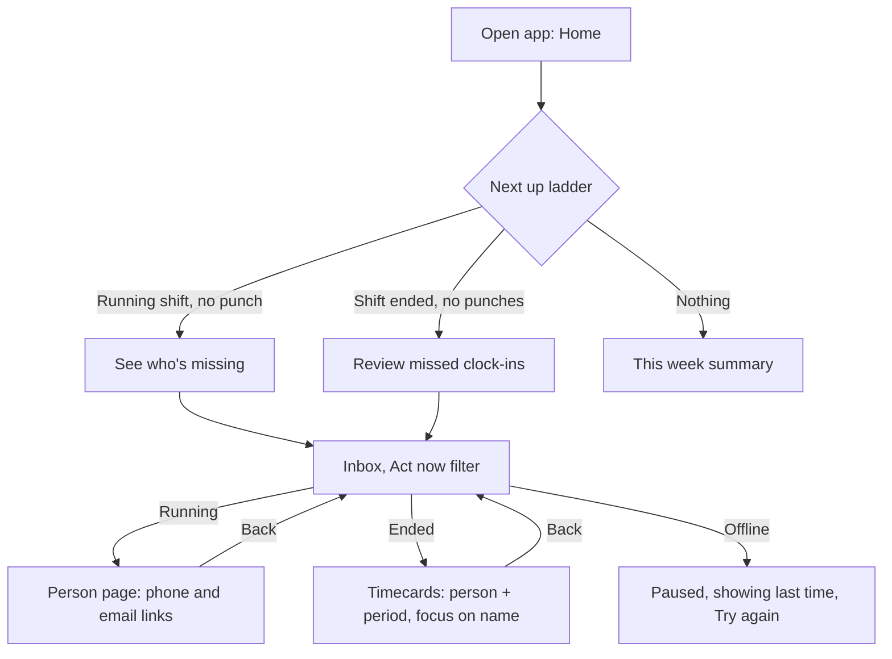
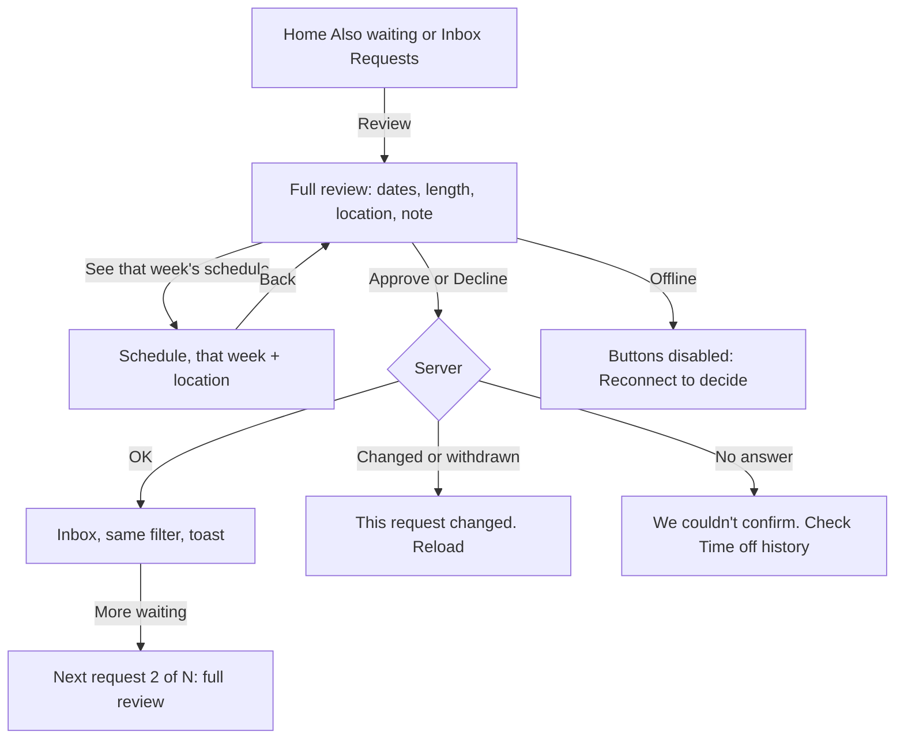
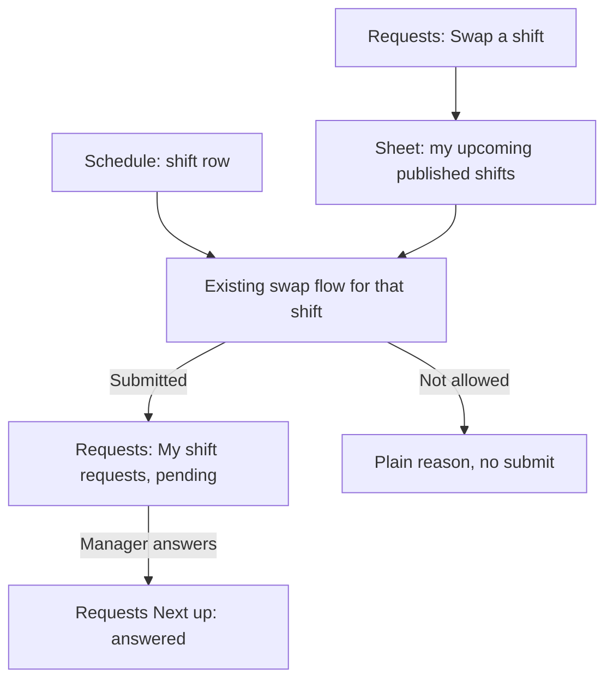

# Premium direction: flows and information architecture review

October 18, 2026 · UX Designer · Manager, Owner, Employee and Lead

## Verdict

**The direction is right. Ship it after five fixes.** Four tabs plus More, one job per place, decisions only on the full review screen, and context carried into destinations together answer most of the manager review (D1, MG1, MG2, MG4) without breaking muscle memory. The comps still disagree with themselves on counts, Back labels and names. Those disagreements would undo the trust the new structure earns.

Fix these before build:

1. **One count contract.** In the comps, the Home summary, the Inbox tab badge, the Inbox summary and the filter chips count different things (details in section 2.3).
2. **Back follows where you came from, not where the page lives.** The review screen says "‹ Requests" when the manager came from Inbox or Home.
3. **No "Approve" on a list row.** Owner Home shows a payroll row whose button says "Approve" and opens a review. Call it "Review", as the time-off row already does.
4. **One name per place.** "Team" is used three times (tab, More group, desktop sidebar group), and the time-and-pay family has four different tab sets across the comps and the code.
5. **Employees need the same structure, not a copy of the manager screens.** The comps cover only Manager and Owner. Section 3 gives employees and leads a matching IA built on the current pages.

## Evidence and limits

- Read: `docs/product/TEAM-RULES.md`, `src/lib/navigation.ts`, `.21st/DESIGN.md` (U1 to Error pass), both October 18 mobile reviews and their evidence, the 17 comps in `scratchpad/canvas/project/*.dc.html`, and shots `p1-*`, `p2-Schedule`, `r2-Home-Refined`.
- Code I checked for the claims below: `src/app/app/requests/actions.ts:58-80`, `src/components/manager-today.tsx:72`, `src/app/app/timecards/page.tsx:8-12`, `src/app/app/schedule/page.tsx:266`, `src/app/app/schedule/new/page.tsx:34-36`, `src/app/app/profile/page.tsx:16`, `src/components/app-shell.tsx:238-260`, `src/lib/capabilities/policy.ts:6-40`, `src/lib/data/employee-home.server.ts:108,235`.
- I did not run the live preview for this review. The comps are static HTML. Treat every interaction claim as design intent, to be checked in the browser at 320, 390 and 1440 px, with a keyboard and with reduced motion, once built.
- Mobbin references: [American Airlines Home](https://mobbin.com/screens/8c235e1a-f757-49a2-a732-a3f2750c1fff) (one trip card above the fold, four tabs plus More), [Future Pro Home](https://mobbin.com/screens/2b5839c4-0519-4df7-9341-bd7fd3a0f60b) (greeting, then one event card, the existing U2 reference), [Fiverr request detail](https://mobbin.com/screens/ded9cbee-b405-42dc-a7dc-bf61fa428971) (request facts, optional reply, then Accept and Decline at the bottom), [Cash App pending detail](https://mobbin.com/screens/75c64504-9371-456e-a07c-e5dc9fe59431) (status line, one action).

---

## 1. Key journeys end to end

Step counts are taps from opening the app on a phone. "Today" is the captured runtime in the two reviews; "New" is the comps.

### 1.1 Manager and Owner

#### J1 · Morning check

| | Steps | Notes |
|---|---|---|
| Today | Home (tiles + 40-task queue) → scroll → Open inbox → Inbox repeats the 40 tasks with missed punches on top | MG2: two lists of the same work. Evidence `manager…/evidence/01-home-390.jpg`, `03-inbox-390.jpg` |
| New | Home: band summary → Today strip → Next up → Also waiting → This week. 0 taps to know the day. | `r2-Home-Refined.png` |

**Remaining friction**
- The summary sentence counts groups while the badge counts records. Manager Home says "2 things need you today" while the Inbox badge reads 4 (`Home-Manager.dc.html`).
- "Updated 6:14 PM" never goes stale visibly. The snapshot expires after 60 s (B4), so after that the Home is showing old numbers with no signal.
- With two or more locations the Today strip is a single total. A manager covering Main Office cannot tell that the "2 not in yet" are both at West Office.

**Fixes**
- The summary uses nouns and the badge number: "2 missed clock-ins and 1 request need you." Never "things".
- After expiry, the timestamp becomes "Paused · showing 6:14 PM" with Try again (the pattern `State-Home-Offline` already uses).
- With more than one location, show a line under the strip, "Main Office 0 · West Office 2". It links to Inbox filtered to Act now.

#### J2 · Missed clock-in

| | Steps | Notes |
|---|---|---|
| Today | Inbox → Review timecard → generic `/app/timecards` → find the person again (3+ taps and a search) | MG4; `manager-today.tsx:72` links to `/app/timecards` with no person or period |
| New | Home Next up → See who's missing → Inbox (Act now) → Timecard → Timecards opened on the person, back says "‹ Inbox" (3 taps) | `Timecards.dc.html` shows "From Inbox" and the person pinned |

**Remaining friction**
- **Backend flag.** `/app/timecards` accepts only `start` and `end` (`timecards/page.tsx:8-12`). Cards have `#timecard-<id>` anchors (D2), but the Today reader gives `employeeId`, not a timecard id. Either add an `employee` query param that filters or scrolls the existing list on the client (UI only, if the list already holds employeeId), or add the timecard id to the Today read model (backend).
- The comps treat both cases the same way. A shift still running ("Started, not clocked in") needs a way to reach the person; a shift that ended needs the timecard. Home-Owner uses "See who's missing" and Home-Manager uses "Review missed clock-ins", which is correct. The Inbox rows, though, all say "Timecard".
- The employee never hears that their shift ended with no punches (see E6).

**Fixes**
- Row action follows the state, as `manager-today.tsx:73` already does: running shift → "Contact" (person page, with phone and email as `tel:` and `mailto:` links where the record has them; nothing is sent by the app); ended shift → "Timecard".
- Opening a timecard from Inbox scrolls to the person, expands their Details, moves focus to their name, and keeps the period.

#### J3 · Time-off decision

| | Steps | Notes |
|---|---|---|
| Today | Inbox row → Approve or swipe, without dates or note (D1). After the decision you land on Time off, not Inbox (`actions.ts:79`). | `03-inbox-390.jpg`, `05-timeoff-review-390.jpg` |
| New | Home or Inbox → Review → full review (dates, length, location, note, "See that week's schedule") → Approve or Decline → back in Inbox with "Time off approved · Alexandra · Oct 28 – 29" | `Request-Review.dc.html`, `State-Approved.dc.html` |

**Remaining friction**
- **Backend flag (needs Jose's approval, already deferred in U4).** `reviewTimeOffAction` always redirects to `/app/requests?tab=pending&reviewed=1`. Returning to Inbox needs a validated `returnTo` field limited to internal paths, so it cannot become an open redirect.
- The Back label reads "‹ Requests" whatever the origin.
- "See that week's schedule" leaves the review. Coming back must restore the review, not the Inbox.
- Decline has no reason field (`actions.ts:58-80` reads only `requestId` and `decision`). Don't add one in the UI without a server field. Recorded as an open question.
- With several requests waiting, the manager goes review → Inbox → review → Inbox.

**Fixes**
- Back label and target come from the origin (section 2.2).
- After a decision, if more requests are waiting, the confirmation offers "Next request (2 of 3)". Each one still opens its full review, so nothing is decided from a list (A5).
- If the request was withdrawn or changed while the manager was reading, show the existing plain notice "This request changed. Reload to see the latest." in place of the buttons. Never a silent failure.

#### J4 · Publish a week

| | Steps | Notes |
|---|---|---|
| Today | Schedule (3,297 px) → scroll past every person → Build and publish → publish per location | MG5; `10-primary-schedule-390.jpg`, `11-build-publish-390.jpg` |
| New | Schedule → Next up "Publish West Office" → Review and publish (2 taps to the review) | `p2-Schedule.png` |

**Remaining friction**
- No comp shows what "Review and publish" reviews. This is the step where a mistake reaches employees.
- After publishing there is no success state or next step.
- Nothing says what Next up shows once every location is live.

**Fixes**
- Pre-publish screen, one location at a time, built from data the build-and-publish page already reads: location and week, shift count, people with shifts, open coverage gaps that remain, people over their weekly limit, and the sentence "Employees at West Office will see this week." Don't promise a push notification unless the server sends one.
- Primary action: "Publish West Office". Never "Publish all". Keep per-location publication states (MG5).
- Success: back on Schedule with "West Office is live" and the location chip turning to live. Next up moves to the next item on the ladder (section 2.4).
- Offline: the button is disabled with "Reconnect to publish". If another manager changed the week, show the server's refusal and offer Reload.

#### J5 · Add a shift

| | Steps | Notes |
|---|---|---|
| Today | Schedule (Sunday selected) → Add shift → form defaults to Monday, Oct 12 → change the date | MG4; `27-create-shift-390.jpg` |
| New | Schedule → Add shift (bottom bar) → form already holds the day and location | `p2-Schedule.png` |

**Remaining friction**
- **UI only, no backend.** `/app/schedule/new` already reads `date` (`new/page.tsx:34-36`). The link at `schedule/page.tsx:266` has to pass it.
- In "All" locations, the form has to ask for a location. It must not quietly pick the first one.
- The "7 not working today" group gives no way to assign one of those people.
- What happens when a shift is added to an already published week? The comps don't say. Confirm the server behaviour before designing it.

**Fixes**
- Each row in "7 not working today" gets an "Add shift" action that carries person, day and location.
- After save, return to the same day and location with the new shift briefly highlighted (static under reduced motion) and focus on it.
- If the week was live, show the shift as a draft change with the existing draft styling, and have Next up offer to publish again. This depends on the open question above.

#### J6 · Onboard a person

| | Steps | Notes |
|---|---|---|
| Today | Team → Add employee (sectioned form with What happens next) → profile. Positions, locations and weekly hour targets live elsewhere (Scheduling rules). | `29-add-employee-390.jpg`, `16-employee-scheduling-390.jpg` |
| New | Team → Add person → … | `Team.dc.html`. The comps stop at the button. |

**Remaining friction**
- "Add person" breaks the B2 contract: Add buttons use the company's word (`words.person`), so it should read "Add employee", "Add associate", "Add caregiver" and so on.
- After creation the person is not ready to schedule, and nothing tells the manager that. The "Operational review is unavailable…" message has no link (MG4).

**Fixes**
- Button: "Add {words.person}".
- After creation, the person's page opens with a short "Ready to schedule" checklist. Each row links to the right section with the person preselected: portal access, positions, location, weekly hour target, availability (theirs, read-only). The checklist uses existing data only and disappears when complete. The Team summary "Ready for next week" links to the same checklists.

#### J7 · Approve payroll (Owner, or a reviewer with `canReview`)

| | Steps | Notes |
|---|---|---|
| Today | More or sidebar → Payroll → run → stepper → review → approve | U6 |
| New | Home "Also waiting: Payroll Sep 21 – 27 · Approve" → Payroll review → checkbox → "Approve revision 2" (2 taps to the review) | `Home-Owner.dc.html`, `Payroll-Owner.dc.html` |

**Remaining friction**
- The Home row button says "Approve" but opens the review. That contradicts decision rule D1.
- The comp says "Payday Tue, Sep 29" on Oct 18. If the fixture date is real, the payday has passed and the row still reads as future.
- The Owner Home counts payroll among the "3 things", but no Owner Inbox comp shows payroll. Home and Inbox would then disagree.
- A manager without review rights must never see the row (this already follows `payroll.canReview` in `navigation.ts:94`).

**Fixes**
- Row button: "Review".
- When the date has passed, use the past tense: "Payday was Tue, Sep 29." Don't add "overdue" or any deadline the run does not provide.
- Payroll approval that waits on this person appears in the Owner's Inbox under Act now and counts in the badge. If the PM decides it should not, it leaves the Home summary too.
- The payroll copy ("I reviewed revision 2, the provider amounts and all employee details.", "Approve revision 2") stays exactly as approved.

### 1.2 Employee and Lead

The comps don't cover these. "Today" is `employee…/evidence/*`; "Proposed" is section 3.

#### E1 · See my next shift

| | Steps | Notes |
|---|---|---|
| Today | Home: the next-shift pass is the first card, then View schedule. 0 taps. | `15-home-after-restart-390.jpg` |
| Proposed | Same pass, under a compact band whose summary names the shift: "Next shift tomorrow, 8:00 AM at Main Office." | E-Home wireframe, section 3 |

- **Friction.** "Shifts shown are final" may overpromise (employee review M8). While on shift, the pass should say "Now · until 4:00 PM" next to the clock status. The clock status card is 1 of 5 cards and repeats "Off Clock" with no action, because employees punch on the Clocker.
- **Fix.** "Published · your manager may still change it" (wording for the PM to confirm). During a shift the pass changes to "On shift now". Clock status shrinks to one line inside the pass ("Clocked in 7:58 AM", "No punch yet"), with My time as the link.

#### E2 · Request time off

| | Steps | Notes |
|---|---|---|
| Today | Home quick action or Requests → Request time off → form → submit → lands on Time off "My requests" with a confirmation (`actions.ts:55`). 3 taps plus the form. | `07-requests-390.jpg`, `09-timeoff-390.jpg` |

- **Friction.** The form doesn't show whether the employee is scheduled in that range. Back from the form goes to the Time off tab, not to wherever the employee started (Home).
- **Fix.** Once dates are chosen, a read-only note from the employee's own published schedule (`self.schedule.read`): "You have 2 shifts in these days. Your manager will see this request." Use an existing read; if the form can't reach one, flag it to backend and don't guess. Back returns to the origin.

#### E3 · Swap or claim a shift

| | Steps | Notes |
|---|---|---|
| Today, swap | Requests → Swap a shift ("Starts in My schedule") → My schedule → find shift → swap options. The Requests entry is a detour. | `07-requests-390.jpg` |
| Today, claim | Schedule → Open shifts → View and claim → marketplace → submit. Blocked shifts list their reasons (B3). | U3, B3 |

- **Fix.** "Swap a shift" opens a sheet listing the employee's upcoming published shifts. Choosing one goes straight into the existing swap flow for that shift. Same data, same commands, one less screen. Requests → My shift requests keeps tracking.
- **Lead.** Shifts that need a qualified lead show a "Shift lead" tag in Open shifts. B3's "It needs a qualified shift lead" reason already covers employees who aren't leads.

#### E4 · Check hours and pay

| | Steps | Notes |
|---|---|---|
| Today | Pay tab → Statements · Hours · Timecards (Timecards now stays in the family: `navigation.ts:182-185`, employee M7). | `11-pay-390.jpg`, `12-hours-390.jpg`, `16-timecards-390.jpg` |

- **Friction.** Three tabs with no line saying how they differ. Statements carry no amounts (U6), so "Pay" can feel empty. Nothing tells the employee where to fix a wrong punch.
- **Fix.** One summary line per tab (section 3.4), and a "Something wrong? Ask for a correction" row on each timecard day that opens the existing correction request for that day (`self.time.request`). Any change to payroll copy goes through the approved-copy review.

#### E5 · Set availability

| | Steps | Notes |
|---|---|---|
| Today | Requests → Availability → usual-week editor. The "Submit separately for a specific week" option appears only when a deadline exists (`availability/page.tsx:160-165`, employee M5). | `08-availability-390.jpg` |

- **Fix.** Employee M5 as written: a visible "Usual week | Specific week" switch, and a plain reason when no dated week is open. When a deadline exists, Requests' Next up becomes "Send availability for Oct 26 – Nov 1 · due Thu, Oct 22" (from the deadline data, never invented).

#### E6 · My shift ended with no punches (journey missing today)

- **Today.** The manager sees it in Inbox. The employee sees nothing on Home. Their only path is to open Timecards and spot an empty day.
- **Proposed.** A Home To do row: "Sun, Oct 18 · 8:00 AM shift has no punches · Ask for a correction".
- **Backend flag.** The Today reader is management only (`/api/manager/today`, B4). The employee Home sources are schedule, acknowledgements, exchanges, timeOff, ownTime and communications (`employee-home.server.ts:235`). This needs a new own-scope read. It is not a UI-only change.

#### E7 · Confirm my schedule (required review)

- **Today.** Home To do lists it. On Schedule, the Confirm card sits below seven days of shifts and a notice (`06-schedule-390.jpg`), with a "Your manager asks you to confirm this week ↓" jump banner above.
- **Proposed.** Schedule's Next up card becomes "Confirm this week" with one primary action. The week list stays above the confirmation as the review content (kept from the employee review: schedule before confirmation). The button scrolls to the confirm card, or it confirms from the card after the list has been shown. The second option needs the PM to agree that seeing the list counts as review.

---

## 2. Navigation and naming consistency

### 2.1 One name per place

| Place | Phone tab | Desktop sidebar | Page title | More group | Section tabs | Problem in comps or code | Recommendation |
|---|---|---|---|---|---|---|---|
| People | Team | words.people ("Employees") in code; "Team" in comps | Team (comp) | "Team" group holds Updates and support tools | n/a | "Team" is a tab, a More group and a sidebar group header. In `Desktop-Home.dc.html` the sidebar lists "Team" under Plan and again as a group heading. | Phone tab "Team" (short and fixed; Spanish "Equipo"). Page title and desktop item use `words.people`, per B2. Rename the More group to **"Team tools"**. On desktop keep the code's groups (`managementNavigationGroups`: Plan, Team, Time & Pay, Workspace) and put the people item **inside** the Team group, as the code already does. |
| Decisions | Inbox | Inbox | Inbox | n/a | n/a | Filter chip "Plan", heading "Plan next week", text "Planning" | One word: **Planning**, for the chip and the heading. The heading gives the week: "Planning · Oct 19 – 25". |
| Time and pay family | (More) | Timecards, Payroll | n/a | "Time and pay" | Code: Timecards · Payroll runs · Time exports · Payroll settings. Comp Timecards: Timecards · Time exports · Attendance. Comp Payroll: Timecards · Payroll runs · Exports · Settings. | Four tab sets for one family | **One row, one order, shown on every page in the family:** Timecards · Attendance · Payroll runs* · Time exports · Payroll settings*. *Only for roles that can open them, as `sectionTabsFor` already filters. |
| Export | More item | (tab) | n/a | n/a | "Time exports" | Sidebar and More label "Payroll export" (`navigation.ts:28`), tab "Time exports", comp "Exports" | **"Time exports"** everywhere visible. Keep the `/app/payroll-export` URL and keep "payroll export" as a ⌘K synonym. Migration note: the old label stays a search term. |
| Attendance | More item | (tab) | n/a | Time and pay | new tab | Lives today at `/app?view=attendance`, inside the legacy dashboard shell (MG1) | Give it its own route and add it to `navigationForRole`. The old URL redirects. Its correction review keeps its own authority. |
| Personal | More › You | Account menu (Owner); comp shows "You: My pay" in the **manager** sidebar | n/a | You | n/a | D3 moved My pay to the account menu for both roles; the manager desktop comp undoes that | Account menu on desktop for both roles, as in D3. More › You on phones. |
| Account recovery and Clocker lookup | More › Team tools | Home rail shortcuts (D3) | n/a | "Help someone sign in", "Find a Clocker action" | n/a | The new names are good; the page titles still say "Account recovery" and "Action recovery review" (MG10) | Make each page title match its entry. Keep the URLs. |
| Alerts | Bell | Bell | Notifications | n/a | n/a | Notifications page heading "Your inbox" (MG10) clashes with Inbox | Heading "Notifications". The word "inbox" belongs only to the decisions place. |

Continuity for every row: URLs don't change, old labels stay as ⌘K synonyms, and each moved entry is still one step away. This meets the TEAM-RULES requirement that "a move or rename needs a stated reason and a migration note".

### 2.2 What Back does

| Situation | Rule | Platform notes |
|---|---|---|
| Tab root (Home, Inbox, Schedule, Team; employee Home, Schedule, Requests, Pay) | No Back. Tapping the active tab returns to the tab root, or scrolls to the top if already there. | Same as iOS and Android. On desktop the sidebar item does the same. |
| Detail opened from a list or card | Top-left "‹ {origin}" naming the place you came from: "Inbox", "Home", "Schedule", "Alexandra Rivera". Returns to the same filter, scroll position, day and location. | The origin comes from a `from` param checked against an allowlist of internal paths. Fallback: the owning tab root. |
| Hardware or browser back, Android back, iOS edge swipe | Same result as the on-screen Back | Edge swipe in an iOS standalone PWA must be tested on a device. Don't promise it. |
| After a mutation (approve, decline, publish, save) | Replace the history entry, so Back never lands on a form that has already been decided | Same on desktop: browser Back after Approve goes to the Inbox, not to the review. |
| Inbox filters, section tabs, location chips, day picker | Change the URL with replace, not push. Back leaves the place in one step and does not cycle through filters. | Filter state survives in the URL, which is what makes "Back returns to the filter" work. |
| Sheets (More, the swap picker, ⌘K) | Escape, swipe down or Android back closes the sheet and returns focus to the control that opened it | U1 already does this for More. |

The comp's "‹ Requests" on `Request-Review.dc.html` and the static "‹ Inbox" on `Timecards.dc.html` should both come from this rule.

### 2.3 Badges and counts mean the same thing everywhere

What the comps show:

| Comp | Home summary | Tab badge | Inbox summary | Chips |
|---|---|---|---|---|
| Manager | "2 things need you today" | Inbox 4 | "3 missed clock-ins and 1 request need you." | Act now 3 · Requests 1 · Planning 39 |
| Owner | "3 things need you today" (2 not in yet + time off + payroll) | Inbox 3 | not shown | not shown |
| Desktop Inbox | n/a | Inbox 4 | same | Planning 39, but the visible rows add up to 37 (21 + 10 + 5 + 1). The other 2 are "Waiting on your team". |

**Contract (A1):**
- **Inbox badge** = Act now + Requests: the records waiting for *this person's* decision or intervention. Planning and "Waiting on your team" are excluded. The same number appears in the Home summary, the Inbox summary, the desktop sidebar count and the tab's accessible name ("Inbox, 4 need you").
- **Chip count** = the number of rows under that filter. A grouped card counts its members ("Coverage gaps 21" counts 21). "Waiting on your team" gets no chip and no count in the badge.
- **Home summary** uses the same nouns as the Inbox summary. If the number is 0: "Nothing needs you right now."
- **Bell** = unread personal notifications only. Today the employee bell shows a number (`15-home-after-restart-390.jpg`) and the manager comps show a dot. Use **a dot for both roles on phones**, with the count in the accessible name ("Notifications, 3 unread"), so the Inbox badge is the only number in the top chrome.
- **Employee tabs carry no badge in this phase.** Home To do already holds required work. A dot on Schedule for "confirm this week" is a later option.
- **Backend flag.** No tab badge exists today (`app-shell.tsx:238-260` renders no count; U4 deferred "An Inbox tab badge needs a count on every page"). The shell needs a light count read, paused offline and in background tabs, using the `useActionCenter()` rules.

### 2.4 "Next up" picks exactly one item, by a fixed ladder

The comps show Next up on Home and Schedule but don't say how the item is chosen. If it isn't predictable, people stop trusting it.

| Page | Ladder, first match wins | When nothing matches |
|---|---|---|
| Manager/Owner Home | 1. Started, not clocked in (running shifts) · 2. Shifts that ended with no punches today · 3. Requests, oldest first · 4. Payroll approval waiting on this person · 5. Next week has an unpublished location · 6. Availability deadline within 48 h | No card. The page goes from the strip to This week. |
| Schedule | 1. Selected week has an unpublished location with shifts → Publish {location} · 2. Upcoming coverage gaps in the selected week → Fill gaps · 3. Nothing | No card |
| Employee Home | The next-shift pass is always first. Next up below it: 1. Required review (confirm schedule, acknowledge update) · 2. A request needs your response (swap offer) · 3. Availability due | Pass only |
| Employee Schedule | 1. Confirm this week · 2. Open shifts you can claim (count) | No card |
| Employee Requests | 1. Availability due · 2. A request was answered since your last visit | No card |
| Employee Pay | 1. New statement since your last visit · 2. A correction request was answered | No card |

Each ladder lives in one pure function per page with table tests, as `src/lib/celebrations.ts` does, so the order can be checked.

---

## 3. Employee and Lead IA

Tabs stay as they are (`mobileTabsForRole`, `navigation.ts:142-149`): **Home · Schedule · Requests · Pay** (Hours when payroll or Pay statements is off) **· More** (Profile, Updates, Notifications, Sign out).

Header: use the new band structure (eyebrow, title, one-line summary), shorter than the manager's. On Home the band must not compete with the green next-shift pass, which U2 made the single brand-colour moment. **Open question for the UI Designer:** a short teal band with the pass overlapping its edge (as the Today strip does on manager Home), or a white header on Home only.

### 3.1 Home: "What's my next shift, and do I owe anything?"

```
┌──────────────────────────────────┐
│ NEVORA Workforce          ○ (•)  │  bell = dot
│ SUNDAY, OCTOBER 18               │  eyebrow
│ Good afternoon                   │  title (name when supplied)
│ Next shift tomorrow, 8:00 AM.    │  summary
│┌────────────────────────────────┐│
││ Next shift            Published││  green pass (U2), unchanged
││ Tomorrow · Mon, Oct 19         ││
││ 8:00 AM – 4:00 PM              ││
││ Starts in 14 h 8 min           ││
││ Main Office · Customer Support ││
││ No punch yet · My time ›       ││  one-line clock status
││- - - - - - - - - - - - - - - - ││
││ View schedule               →  ││
│└────────────────────────────────┘│
│┌ Next up ───────────────────────┐│
││ Confirm this week's schedule   ││  ladder 3.1
││ Week of Oct 12 · required      ││
││ [ Review schedule  › ]         ││  one primary
│└────────────────────────────────┘│
│┌ Also to do (2) ────────────────┐│
││ Read update: team schedule   › ││
││ Schedule updated, Oct 19     › ││
│└────────────────────────────────┘│
│ Quick actions  [Time off][Swap]  │
│                [Availability][Hours]│
│ Recent activity …                │
│ Updated 5:51 PM · Refresh        │
├──────────────────────────────────┤
│ Home  Schedule  Requests  Pay  More│
└──────────────────────────────────┘
```

- **Summary line by state:** "Next shift tomorrow, 8:00 AM." · "On shift until 4:00 PM." · "No published shifts coming up." · "West Office hasn't published this week yet." (partial, known state from the Error pass) · offline: "You're offline. Showing 5:51 PM."
- **Keep the existing script contracts** (U2): next shift before To do, "You're all set.", "Refresh home", the `data-home-*` attributes.
- **Recent activity** stays below quick actions. It is history, not work.

### 3.2 Schedule: "When do I work, and what can I pick up?"

- Band: eyebrow "Oct 12 – 18", title "My schedule", summary "5 shifts · 40h scheduled" (from the published assignments already listed; the label says "scheduled", not "worked").
- My shifts | Open shifts switch (U3) right under the band.
- Next up per the ladder (Confirm this week; or "2 open shifts you can pick up").
- Week list, then "Your full week is not published yet" when partial, then What changed, then Planning ahead links (keep the order from U3 and the employee review).
- **Lead only:** "Shift lead" tag on shifts that need a lead.

### 3.3 Requests: "Ask for something and see where it stands"

- Band: title "Requests", summary built from data: "1 time-off request waiting" / "Nothing waiting on your manager."
- Keep the Overview structure (Start a request / Track your requests). The employee review praised it (`07-requests-390.jpg`).
- Next up: availability due, or "Your time off for Oct 28 – 29 was approved" once per answer (seen state kept on the device, like U7's gate).
- "Swap a shift" opens the shift picker sheet (E3).
- Section tabs stay: Overview · Time off · Shift requests · Availability.

### 3.4 Pay (or Hours): "What did I work and what was I paid?"

| Tab | Summary line (pending approved-copy review) | Next up |
|---|---|---|
| Statements | "Statements from your payroll provider." | New statement since your last visit: "Payday Fri, Oct 16 · Open statement" (the Payday moment, U6) |
| Hours | "Recorded hours for this pay period." | Correction answered |
| Timecards | "Each day's clock-ins and clock-outs." | A day with no punches (needs E6's backend read) |

No amounts appear anywhere on Pay, because statements don't carry them (U6). A breakdown is a backend change.

### 3.5 What stays role-specific

| | Employee | Lead | Manager | Owner |
|---|---|---|---|---|
| Tabs | Home, Schedule, Requests, Pay/Hours | same as Employee | Home, Schedule, Inbox, Team | same as Manager |
| Inbox and approvals | none | none (`request.review` is management only, `policy.ts:28`) | yes | yes |
| Shift lead shifts and eligibility | n/a | yes | assigns | assigns |
| Post team updates | if the company grants it (`communication.team.author`, TEAM grant) | same | yes | yes |
| Payroll review | n/a | n/a | only with `canReview` | yes |
| Settings | n/a | n/a | Scheduling rules only | Settings hub |
| Profile | More › Profile | same | **none today** (`profile/page.tsx:16` sends managers to /app) | none today |

**Open question for the PM:** managers and owners have no place for their own app settings (notifications, calendar). `profile.self.read` covers all roles (`policy.ts:20`), but the page refuses them. Either add Profile under More › You and the account menu, or confirm that managers do without it.

---

## 4. Edge cases the comps don't show yet

| Case | Where | How it should look and behave |
|---|---|---|
| **Many items** | Inbox Act now with 12 missed punches | Show the first 5 rows, then "Show all 12". The Act now chip still says 12. Missed punches at one location group into one expandable card, using U4's three-or-more rule. Time-off rows never group (U4). |
| | Requests with 9 waiting | Oldest first. Each row shows dates and length. "Next request (2 of 9)" on the review screen (A5). |
| | Home Also waiting | At most 3 rows, then "Open Inbox (9)". |
| | Schedule day with 30 people | Working people first; "N not working today" collapsed (as in the comp). Search sits above the list when there are more than 15 people. |
| **Zero items** | Home | The band says "Nothing needs you right now." No Next up card. The strip and This week stay. |
| | Inbox | `State-Inbox-Clear` is good. Keep Planning visible as optional. |
| | Brand-new workspace (no people) | Home Next up: "Add your first {words.person}". The strip shows "No published shifts yet", never "0 · 0 · 0". |
| | Employee with no upcoming shifts | The calm white card (U2) plus a link to Open shifts when any are claimable |
| **Long names** | Rows | One line, truncated with an ellipsis. Full name in the accessible name and on the detail screen. The comp already tests "María José Rivera Santiago With A Long Name". |
| | Review header and band title | Wrap to two lines, never truncate: the decision has to name the person in full. |
| | Spanish (+25–35% length) | Band summary wraps to 2 lines. Chips scroll sideways with an edge fade (U1). Tab labels "Inicio · Horario · Bandeja · Equipo · Más" fit in 5 × 78 px at 390 px; at 320 px check that "Solicitudes" (employee Requests) doesn't clip. |
| **Multiple locations** | Home strip | Per-location line under the strip (J1). |
| | Inbox | With 2 or more locations, rows show "· Main Office". Group headers by location only when one kind spans locations. |
| | Schedule | Location chips with status dots (live or draft). The band summary names each location's state, as the comp does. With more than 4 locations, the chips scroll and the summary says "2 of 6 live". |
| | Location-scoped managers | B4 notes they see the whole workspace. Until the server scopes the data, don't show a location filter that implies it does. |
| **Offline mid-action** | Approve tapped, connection drops | Keep "Approving…". If there's no answer, show "We couldn't confirm this. Check Time off history before trying again", with a link. The server action re-checks state, so a retry can't decide twice. Don't use an optimistic "Approved". |
| | Offline before tapping | Approve, Decline, Publish and Save are disabled, with "Reconnect to decide/publish/save" under them. Reading stays possible. |
| | Form filled offline (Add shift, time off) | Keep the fields. Disable submit with the reason. Don't queue a mutation in the background: the service worker must not replay business commands. |
| **Stale data** | Home and Inbox past the 60 s expiry | "Paused · showing 6:14 PM" and Try again. Rows stay readable. Opening one re-reads the record. |
| | Review screen left open | On submit, the server's stale refusal appears in place: "This request changed. Reload to see the latest." (Error pass wording). |
| | Schedule edited by someone else | Publish shows the server's refusal and Reload. Never "Published". |
| **Permission denied** | Role changed mid-session | The page shows "You no longer have access to this page." with Home. No data from before the change stays on screen. |
| | Self-review | Timecard row: "Another manager approves" (comp `Timecards.dc.html`). Same on time off for a manager's own request. |
| | Module off | B2's calm "… is turned off" page. Owners get the link to turn it on. The badge and chips drop the module's items. |
| | Deep link to a person the manager can't manage | Same denied page. A deep link never implies authority (MG4). |
| **Dates** | Payday already past | Past tense (J7). |
| | Overnight shift | "10:00 PM – 6:00 AM (next day)". Home counts it on the start day and while it is still running (B4). |
| | All-day coverage | "All day" (D4). |
| **Partial sources** | One Home source fails | Only that section says it couldn't load, with Try again. The others render. Counts read "at least N", as in the existing Home notice. |
| **Large text / zoom 200%** | Strip and tiles | Tiles stack to one column. The band summary wraps. Next up's button stays full width and stays 44 px or taller. |
| **Reduced motion** | Highlights, sheets, toasts | No movement. The highlight is a static tint for 2 s; toasts appear without sliding. |

---

## 5. Further improvements, in priority order

Scores follow the TEAM-RULES order: Usability / Familiarity / Trust / Accessibility / Brand / Durability / Cost / Continuity. Accessibility stays at 1 until built and tested.

| # | Pri | Improvement | Acceptance criteria | Backend? | Score |
|---|---|---|---|---|---|
| A1 | P1 | **Count contract** (2.3) | In every fixture, the Home summary, Inbox summary, tab badge, sidebar count and accessible name agree. Chip counts equal their rows. A unit test pins the rule. | Shell count read | 2/2/2/1/2/2/1/2 = 14 |
| A2 | P1 | **Origin-aware Back, replace after mutation** (2.2) | From Home, Inbox (Requests filter) and a notification, Back from a review returns to that exact origin and filter. After Approve, browser Back doesn't show the decided form. The `from` value is allowlisted. | `returnTo` on the review action (Jose's approval) | 2/2/2/1/2/2/1/2 = 14 |
| A3 | P1 | **One name per place and one time-and-pay tab row** (2.1) | No visible "Payroll export", "Exports", "Your inbox" or "Plan" left. "Team" names one thing. Old labels still find the page in ⌘K. Every URL is unchanged. | No | 2/2/2/1/2/2/2/1 = 14 |
| A4 | P1 | **List rows never say "Approve"** | Every list or card action that opens a decision reads "Review". Approve and Decline exist only on review screens. A grep-style test fails on Approve inside list components. | No | 2/2/2/1/2/2/2/2 = 15 |
| A5 | P2 | **Next request after a decision** | After deciding 1 of 3, "Next request (2 of 3)" opens the full review of the next one. With none left, "Back to Inbox". Keyboard focus lands on the new review's heading. | Uses A2's `returnTo` | 2/2/2/1/2/2/1/2 = 14 |
| A6 | P2 | **Next up ladders** (2.4) | One pure function per page, with table tests. The card is hidden when nothing matches. It never shows two primaries. | No | 2/2/2/1/2/2/2/2 = 15 |
| A7 | P2 | **Pre-publish review per location** (J4) | It shows location, week, shift count, people, remaining gaps, people over their limit and who will see the week. One button names the location. Offline and stale states are covered. | No (existing reads) | 2/2/2/1/2/2/1/2 = 14 |
| A8 | P2 | **Employee band, summaries and Next up** (3.1–3.4) | Each employee tab root has an eyebrow, title and one data-built summary. Home keeps the pass as its brand moment. U2 script contracts pass. | No | 2/2/2/1/2/2/2/1 = 14 |
| A9 | P2 | **Context carried into destinations** (J2, J5) | Timecard opens on the person and period with focus on their name. Add shift opens on the selected day and location. "Not working today" rows add a shift for that person. | Timecard: maybe (employee param or timecard id) | 2/2/2/1/2/2/1/2 = 14 |
| A10 | P2 | **Swap starts with a shift picker** (E3) | Requests → Swap a shift lists upcoming published shifts. Choosing one opens the existing swap flow for it. Shifts that can't be swapped explain why. | No | 2/2/2/1/2/2/2/2 = 15 |
| A11 | P2 | **"Ready to schedule" checklist for a new person** (J6) | After Add, the person page lists access, positions, location, hour target and availability, each linking to the field. It is hidden when complete. "Add {words.person}" follows B2. | No | 2/2/2/1/2/2/1/2 = 14 |
| A12 | P2 | **Desktop list + detail keyboard model** | Up and Down move through Inbox rows (as in `row-navigation.ts`). Enter opens the detail pane and focus moves to its heading. After a decision, focus goes to the next row. Escape returns focus to the row. | No | 2/2/2/1/2/2/2/2 = 15 |
| A13 | P2 | **Bell dot for all roles; Notifications record context** (employee M6, MG12) | Both roles show a dot with the count in its accessible name. Two schedule alerts are told apart by week when the read model provides it. | Possibly (M6) | 2/2/2/1/2/2/1/1 = 13 |
| A14 | P3 | **Tapping the active tab returns to its root and scrolls to the top** | On every tab root, at both phone sizes, and with the keyboard (Enter on the active tab). | No | 2/2/2/1/2/2/2/2 = 15 |
| A15 | P3 | **Employee missed-punch to-do** (E6) | A shift that ended with no punches shows on that employee's Home with "Ask for a correction", which opens the existing correction for that day. | **Yes**, own-scope read | 2/2/2/1/2/2/1/2 = 14 |
| A16 | P3 | **Time-off form shows my shifts in the range** (E2) | After dates are chosen, a read-only note counts the employee's published shifts in the range. Nothing appears when the read fails. | Maybe | 2/2/2/1/2/2/1/2 = 14 |

Platform notes for all of the above: phones keep the safe-area padding and the 44 px targets. Android back and the iOS edge swipe follow 2.2 (iOS standalone PWA to be checked on a device). Desktop gets the same flows in list + detail, with focus moved on open and close. Mobile web and the PWA share the phone layout. Offline behaviour follows section 4 and never queues business commands.

---

## 6. Flow diagrams

### Manager morning check to missed clock-in



### Time-off decision



### Employee swap



---

## 7. Wireframes for the cases the comps miss

### Inbox with many items (phone, 390)

```
┌──────────────────────────────────┐
│ UPDATED 6:14 PM                  │
│ Inbox                            │
│ 12 missed clock-ins and 9        │
│ requests need you.               │
│ [All][Act now 12][Requests 9][Pla›│  chips scroll, edge fade
│┌ Act now · Shifts with no punches ┐
││ MR Morgan Rivera     Timecard › ││
││    7:00 AM – 3:00 PM · Main Off.││
││ … 4 more rows …                 ││
││ Show all 12                     ││
│└────────────────────────────────┘│
│┌ Requests ─────────── 9 waiting ┐│
││ AR Alexandra Rivera   Review ›  ││  oldest first
││    Time off · Oct 28 – 29 · 2d  ││
││ … 2 more …  Show all 9          ││
│└────────────────────────────────┘│
│┌ Planning · Oct 19 – 25 ── 37 ──┐│  count = rows below
││ Coverage gaps        21       › ││
││ …                               ││
│└────────────────────────────────┘│
│┌ Waiting on your team ──────────┐│  no chip, no badge
│└────────────────────────────────┘│
└──────────────────────────────────┘
```

### Review screen, stale and offline

```
┌──────────────────────────────────┐
│ ‹ Inbox                          │  origin label
│ Alexandra Rivera                 │  wraps, never truncates
│ Time off · Waiting for you       │
│ Dates   Wed, Oct 28 – Thu, Oct 29│
│ Length  2 full days              │
│ Works at Main Office             │
│ Her note "Fictional family …"    │
│ See that week's schedule ›       │
│┌────────────────────────────────┐│
││ (i) This request changed.      ││  stale: replaces buttons
││ [ Reload ]                     ││
│└────────────────────────────────┘│
│  (or, when offline)              │
│ [ Decline ]  [ Approve ]  grey   │
│ Reconnect to decide.             │
└──────────────────────────────────┘
```

Desktop: the same review in the Inbox detail pane (`Desktop-Inbox.dc.html`), with the stale notice in the same place and focus moved to it.

---

## 8. State table

| Screen | Loading | Empty | Error | Offline | Partial | Success | Permission denied |
|---|---|---|---|---|---|---|---|
| Mgr Home | `State-Home-Loading`: band "Getting today's numbers…", skeleton strip | "Nothing needs you right now"; no Next up | Only the failed section says so, with Try again | `State-Home-Offline` (good: "Nothing was changed") | "at least N"; failed source named | n/a | Role lost: denied page |
| Inbox | Skeleton rows, chips without counts | `State-Inbox-Clear` | "Inbox couldn't load", Try again, last time | Paused, rows readable, actions disabled | Missing source named, chips "at least" | `State-Approved` toast, same filter | Denied page |
| Review | Skeleton facts | Request gone: "This request was already decided" + history link | Stale refusal in place | Buttons disabled + reason | n/a | Back to origin + toast, Next request | Self-review: "Another manager decides" |
| Schedule | Skeleton day | "No shifts on Sunday" + Add shift | Roster failed: say so, no empty roster | Edit and publish disabled | Status chips hidden when their read fails (U3) | "West Office is live" | Lead/Employee: own schedule only |
| Pre-publish | Skeleton summary | n/a | Refusal + Reload | Disabled | Gaps or limits unavailable: say so before publishing | Live state | n/a |
| Team | Skeleton rows | "Add your first {person}" | Retry | Read only | n/a | New person + checklist | Edit hidden without authority |
| Timecards | Skeleton | "No timecards for this period" | Retry | Read only | n/a | "Approval recorded" | "Another manager approves" |
| Payroll | Stepper skeleton | "No payroll run yet" | Retry | Approve disabled | Stepper shows the blocked step (U6) | "Approval recorded" + revision | Hidden without `canReview` |
| Emp Home | "Loading Home…" | Calm white card, "You're all set." | Per section | "You're offline. Showing 5:51 PM." | `unpublished` is known, not partial (Error pass) | n/a | n/a |
| Emp Schedule | Skeleton week | "No published shifts this week" | Retry | Confirm disabled | "Your full week is not published yet" | "Schedule confirmed" | n/a |
| Emp Requests | Skeleton rows | "Nothing waiting on your manager" | Retry | Submit disabled, fields kept | n/a | "Request sent" (existing) | Module off: B2 page |
| Emp Pay | Skeleton | "No published statements yet" (approved copy) | Retry | Statement download disabled | n/a | n/a | Module off: Hours tab only |

Reduced motion applies to every column: no slides, the highlight is a static tint, the countdown text updates without animation.

---

## 9. Backend and approval flags

| Item | Why | Where |
|---|---|---|
| Inbox count on every page | Badge on tab and sidebar | U4 deferred; `app-shell.tsx` |
| `returnTo` on time-off review | Return to Inbox after deciding, plus Next request | `requests/actions.ts:79`; U4 says it awaits Jose |
| Timecard deep link by person | Open the right card from Inbox | `timecards/page.tsx:8-12` reads only start/end; `manager-today.tsx:72` |
| Employee own no-punch read | E6 / A15 | The Today reader is management only (B4) |
| Decline reason | Only if the PM wants one | `reviewTimeOffAction` has no reason field |
| Attendance route | Leaves the legacy shell | `/app?view=attendance` (MG1) |
| Manager Profile | Own settings for managers | `profile/page.tsx:16` |
| Notification record context | M6 / A13 | Notification read model |
| Adding to a published week | Draft-change behaviour | Server publication rules, to confirm |

Approved payroll and legal copy is untouched in every proposal. The summary lines on Pay need the approved-copy review before use.

---

## 10. Open questions

**For the PM**
1. Does an Owner's waiting payroll approval count in the Inbox badge (my recommendation), or leave the Home summary?
2. Should declining time off carry an optional reason? It needs a server field.
3. Do managers and owners get a Profile (notifications, calendar)?
4. Wording for "Shifts shown are final" (employee M8).
5. On employee Schedule, does reading the week list count as review, so Confirm can sit in Next up?
6. What should happen when a shift is added to a live week?

**For the UI Designer**
1. Employee Home band: short teal band with the pass overlapping, or a white header on Home only?
2. Bell: a dot for every role. Does that work with the coral dot already on the manager comps?
3. Spanish at 320 px: does "Solicitudes" fit under its tab icon?
4. Inbox chips at 390 px: the fourth chip clips in `p1-Inbox.png`. Is the edge fade enough of a cue that the row scrolls?

---

## Top 10

1. **Count contract (A1).** Badge = Act now + Requests, and the same number appears everywhere. Fixes the comps' 2 vs 4 and 39 vs 37.
2. **Back names its origin and is replaced after a decision (A2).** Fixes "‹ Requests" on the review screen.
3. **"Review" on every list row; Approve only on review screens (A4).** Fixes the Owner Home payroll row.
4. **One name per place (A3).** Team tab, a "Team tools" More group, and one Time-and-pay tab row: Timecards · Attendance · Payroll runs · Time exports · Payroll settings.
5. **Next up ladders (A6),** with the card hidden when nothing matches.
6. **Pre-publish review per location (A7).** Shows what employees will see before they see it.
7. **Context carried into destinations (A9):** person and period on Timecards, the day on Add shift, "Add shift" on unassigned people.
8. **Employee band, summaries and Next up (A8)** on Home, Schedule, Requests and Pay, keeping the green pass as Home's brand moment.
9. **Offline and stale behaviour for every mutation (section 4).** Disable with a reason, never optimistic, never replay.
10. **Next request after a decision (A5)** and the Swap shift picker (A10). Each removes a round trip without deciding anything from a list.
