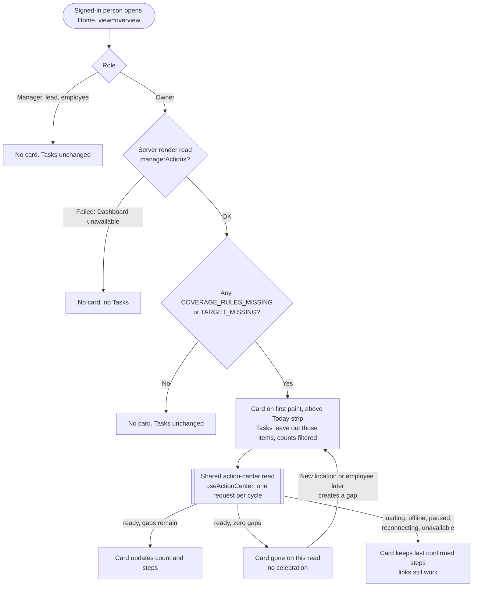
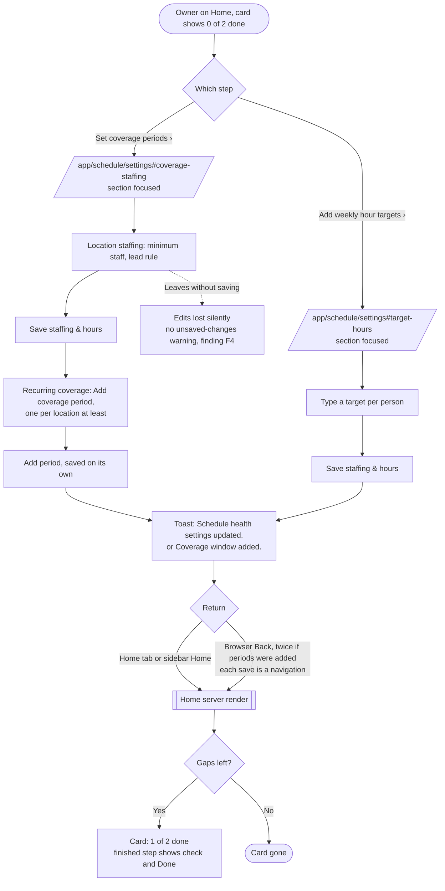

# Owner setup card: flows

- **Initiative:** direction item 10 (A10). PRD: `docs/product/prd-owner-setup-card.md`, including "Decisions (Jose, 2026-10-17)": the weekly availability deadline stays a Task, the card is for Owners only, and extra steps wait for a follow-up.
- **Written:** 2026-10-17 by the UX Designer, cycle 1 design step. The UI Designer's `visual.md` covers the look.
- **Evidence used:** `.claude/evidence/d3/home-1440.png` (Owner Home with setup items in Tasks); `/ui-preview/home` measured live at 390 by 844 as Owner (Tasks start about 746px below the top of the app, under the Today strip and This week, so they sit below the fold on a 844px screen); the code at the paths cited. I didn't sign in to the full portal, so I read `/app/schedule/settings` from its code, not on screen.
- **References:** Shopify iOS "Get ready to sell" card at the top of Home, one row per step with a chevron ([mobbin](https://mobbin.com/screens/32ac5921-43be-435c-88cc-9e29bd8eb23e)); Square web "3 of 6 steps completed" with a quiet bar ([mobbin](https://mobbin.com/screens/9a32644d-c67c-4185-b2f3-f50af9ecf43a)); Klaviyo "3 / 3 completed" per group ([mobbin](https://mobbin.com/screens/709b5146-6c1e-4bb4-9dbf-a0acfab1c271)); Future Pro's "Finish these quick steps" list on Home ([mobbin](https://mobbin.com/screens/2b5839c4-0519-4df7-9341-bd7fd3a0f60b)), the app U2 already adapted.

## Key decisions

1. **One card, first on Home, at every width.** It sits above the Today strip. On phones that moves the first setup link from about 746px down (inside a closed "Review N tasks" disclosure) to the top of the page.
2. **Each step opens the right section, not the top of the page.** Coverage goes to `/app/schedule/settings#coverage-staffing` and hour targets to `/app/schedule/settings#target-hours`. The page already focuses these sections: it mounts `ManagerIssueFocus` for the `staffing-`, `target-` and `coverage-` prefixes (`schedule/settings/page.tsx:42`), and both sections carry `tabIndex={-1}` and the `manager-issue-target` class. The path stays the same as the action item's `href` (AC2.1); only a fragment is added. Without it, the hour-targets step lands an Owner on Location staffing and makes them scroll past it.
3. **The coverage step says what "done" means.** The check needs three things for **every** location: a minimum staff count, a lead rule and at least one coverage period (`manager-dashboard.ts:131-137`). They live in two forms that save separately (the page itself says so). If the step says only "Set coverage periods", an Owner who adds periods but skips the lead rule sees the step stay undone with no reason.
4. **No new way back.** After saving, the Owner returns with the Home tab (phone) or the sidebar (desktop), one tap either way. Home re-renders from fresh server props on that navigation, so the card is current on arrival (AC2.3). I don't add a "Back to Home" link to the settings page; it would be a second path to maintain for no gain.
5. **The card never leaves on a failed read.** It shows the last confirmed steps until a *ready* read says there are no gaps (AC4.3). When it goes, it shows no "setup complete" line and no animation (U7 allow-list).

---

## 1. Flow diagrams

### 1.1 Home render: does the card show?



### 1.2 Finish a step and come back



### 1.3 Edge paths

| Situation | What the Owner meets | Recovery |
|---|---|---|
| No locations yet | The coverage check fails while `staffingSettings` is empty (`manager-dashboard.ts:132`). The step links to settings, where Location staffing shows "Add your first location" with a button | Two steps: add a location, come back, then set staffing. See open question P2 for a reason line that says so up front |
| No employees | No `TARGET_MISSING` items, so the hours step shows Done. The card can show "1 of 2 done" with hours done before anyone exists | Accept: a target can't be missing for nobody. The card stays honest to the check |
| Owner leaves a target blank on purpose | The page tells them that's allowed: "Leave a target blank to leave it out of the hours review." (`page.tsx:97`). The card still counts the blank as missing, so it never finishes | Open question P1 (finding F3) |
| Hour-target count changes while away | A new employee joins and the count rises | The card shows the new count on return. The step stays undone |
| The read fails on return | Card keeps the last confirmed steps; Tasks show "Tasks unavailable" | Refresh in Tasks, or reload. The card never claims Done on a failed read |
| Offline, Owner taps a step | The offline page opens (`fuel-portal-offline.html`) | "Try again" once back online |
| A manager opens Home | No card. Setup items stay in Tasks with their "Setup needed" tag | Unchanged (Jose's decision Q2) |
| The weekly availability deadline isn't set | Not in the card. It stays in Tasks as "Availability deadline not set" with "Set deadline" (Jose's decision Q1) | Unchanged |

### 1.4 Where setup items live (information architecture)

```
Owner Home (overview)
├── Finish setting up  ← NEW (Owner, only while configuration gaps exist)
│   ├── Coverage periods      → /app/schedule/settings#coverage-staffing
│   └── Weekly hour targets   → /app/schedule/settings#target-hours
├── Today strip
├── This week
├── Tasks  (leaves out COVERAGE_RULES_MISSING and TARGET_MISSING while the card shows;
│           keeps DEADLINE_MISSING and AVAILABILITY_MISSING with "Setup needed")
├── Clocked in now (rail), Recent activity, Shortcuts
Inbox (/app/inbox) → To review: still lists every setup item  (unchanged, the complete list)
Scheduling rules  → desktop: Settings hub; phone: More › Scheduling rules  (unchanged)
```

Each setup gap shows once on Home and stays complete in the Inbox. Nothing moves in the navigation, so there is no migration note.

---

## 2. Wireframes

### 2.1 Phone, 390 (iOS Safari, iOS PWA, Android Chrome, Android PWA, later the shell)

```
┌──────────────────────────────────────────────┐
│ NEVORA                          (⌕)  (🔔)    │ masthead
│ Home                                         │
│ Northside QA Workforce                       │
├──────────────────────────────────────────────┤
│ ┌──────────────────────────────────────────┐ │
│ │ Finish setting up                  (h2)  │ │
│ │ 1 of 2 done                              │ │ text carries the meaning
│ │ ▓▓▓▓▓▓▓▓▓▓▓░░░░░░░░░░░░                  │ │ existing .home-progress, aria-hidden
│ │──────────────────────────────────────────│ │
│ │ ✓ Coverage periods              Done     │ │ ladder green, no link
│ │──────────────────────────────────────────│ │
│ │ ○ Add weekly hour targets ›              │ │ link: the step name, ≥ 44px tall
│ │   7 employees don't have one yet.        │ │ noun from B2 words.people
│ └──────────────────────────────────────────┘ │
│ ┌────────────┐ ┌────────────┐               │
│ │ Scheduled  │ │ Clocked in │  Today strip  │
│ │ today  6   │ │ now   4    │               │
│ └────────────┘ └────────────┘               │
├──────────────────────────────────────────────┤
│  Home   Schedule   Inbox   Team   More       │
└──────────────────────────────────────────────┘
```

- Each step row is a separate link with its own focus ring. The card itself isn't one big link (PRD §5).
- The link is the step's own text, ending in "›" (voice guide). The reason line under it is plain text inside the link's row but not part of the accessible name. The UI Designer can fold it into the name if that reads better in VoiceOver.
- With both steps undone, both rows show links and the line reads "0 of 2 done" with an empty bar.

Coverage step copy (suggested; the PRD names the UX writer as the final word):

| State | Link | Reason |
|---|---|---|
| Not done | "Set coverage periods ›" | "Each location needs a minimum staff count, a lead rule and a coverage period." |
| Not done, no locations (P2) | "Add a location ›" | "Then set its coverage periods." |
| Done | "Coverage periods" + "Done" | none |

Hours step copy:

| State | Link | Reason |
|---|---|---|
| Not done | "Add weekly hour targets ›" | "{n} {people} don't have one yet." / "1 {person} doesn't have one yet." Two full strings, never a joined count, so B5 can translate them |
| Done | "Weekly hour targets" + "Done" | none |

### 2.2 Phone, 320, and a 200% root

```
┌────────────────────────────────────┐
│ Finish setting up                  │
│ 1 of 2 done                        │
│ ▓▓▓▓▓▓▓▓▓░░░░░░░░░                 │ count line and bar stay paired
│ ✓ Coverage periods                 │
│   Done                             │ ← "Done" drops under the name
│ ○ Add weekly hour                  │
│   targets ›                        │ ← link wraps; "›" stays with the last word
│   7 employees don't have one       │
│   yet.                             │
└────────────────────────────────────┘
```

### 2.3 Desktop, 1440 and 1920

```
┌─────────────┬──────────────────────────────────────────────────────────────────────┐
│ NEVORA      │ Northside QA Workforce › Plan › Home        [Search ⌘K] (🔔) (FO ▾)  │
│             ├──────────────────────────────────────────────────────────────────────┤
│ Plan        │ Good evening, Fictional                                              │
│  Home       │ Here's what's going on with your team at Northside QA Workforce.     │
│  Inbox      │ ┌──────────────────────────────────────────────────────────────────┐ │
│  Schedule   │ │ Finish setting up                          1 of 2 done           │ │
│ Team        │ │                                            ▓▓▓▓▓▓▓░░░░░░        │ │
│  Employees  │ │ ✓ Coverage periods   Done  │ ○ Add weekly hour targets ›         │ │
│  Requests   │ │                            │   7 employees don't have one yet.   │ │
│  Updates    │ └──────────────────────────────────────────────────────────────────┘ │
│ Time & Pay  │ ┌ Scheduled today ┬ Clocked in now ┬ … after start ┬ Started, not ┐  │
│  …          │ └─────────────────┴────────────────┴────────────────┴──────────────┘  │
│ Workspace   │ Tasks (setup items removed, counts filtered)  │ This week            │
│  Settings   │                                               │ …                    │
└─────────────┴──────────────────────────────────────────────────────────────────────┘
```

The card spans the same width as the Today strip (a `setup` grid row above `today` in `manager-home-gusto.css:175`). Two steps sit side by side on wide screens and stack below about 900px. Keeping it full width, rather than in the rail, keeps it first in reading order (AC on keyboard order) and avoids pushing This week down.

### 2.4 Tasks after filtering (phone and desktop)

```
Tasks                                   (8)  ⟳
Updated 4:49 PM
Showing 8 of 8 tasks                    ← every count uses the filtered list
▌Urgent  Scheduling  14 coverage gaps at Main Office   Review ⌄
 Review  Scheduling  2 employees haven't acknowledged…  Review ⌄
 Setup needed  Scheduling  5 employees haven't submitted availability  Review ⌄   ← stays (weekly)
 Setup needed  Scheduling  Availability deadline not set  Set deadline ›          ← stays (Q1)
[Show all 8 tasks]   Open inbox ›
```

Phone: the disclosure reads "Review 8 tasks" from the same filtered count (AC3.2).

If only card items remained: Tasks shows "You’re all caught up" / "No tasks found in the checked sources." with the card still above it. That's the existing empty state, unchanged (AC3.3).

### 2.5 Preview (`/ui-preview/home`)

Owner at 390 and 1440: the card with fictional gaps (coverage not configured, some targets missing). Tapping a step shows the preview's existing notice ("Set coverage periods is outside this Home-only preview.", built by `stayInPreview` in `home-preview.tsx:89-94`). Manager: no card.

---

## 3. State table

| State | Phone (390, 320) | Desktop (1440) | Keyboard | Screen reader | 200% zoom and 200% root | Reduced motion |
|---|---|---|---|---|---|---|
| **Loading** (first paint) | No skeleton: the server props place the card, so the Today strip doesn't jump | Same | Card links come first in tab order | Section heading "Finish setting up", then progress text | Wraps as 2.2 | No entrance animation |
| **Loading** (live read in flight) | Last confirmed steps stay. Tasks show their skeleton and "Loading tasks…" | Same | Links stay usable | Nothing new announced from the card | Same | Bar width never animates |
| **Empty** (no gaps) | No card. No empty card, no "all set" line | Same | n/a | n/a | n/a | n/a |
| **Partial** (one step done) | "1 of 2 done", ✓ Done row, one link | Same | One link in the card | Done row reads "Coverage periods, Done" | Same | No change |
| **Error** (live read fails) | Last confirmed steps and links stay. Tasks show "Tasks unavailable…" | Same | Same | The card announces nothing; Tasks' status line carries the error | Same | No change |
| **Error** (server read fails) | No card; Home shows "Dashboard unavailable" | Same | n/a | n/a | n/a | n/a |
| **Offline** | Card keeps last steps; Tasks: "Tasks unavailable offline". A step link opens the offline page | Same | Same | Same | Same | No change |
| **Success** (gap fixed) | On return: the finished step shows ✓ Done and the count rises; when both are done, the card is gone | Same | Focus lands where the navigation puts it (top of Home) | Count read as text when reached | Same | No celebration at any setting |
| **Regressed** | Card returns with the new count | Same | Same | Same | Same | No change |
| **Permission denied** (role is not Owner, or "Task access ended") | No card | Same | n/a | n/a | n/a | n/a |
| **B1 company brand** | Links use the brand action colour within the B1 floors; Done stays ladder green | Same | Focus ring follows the brand accent | n/a | n/a | n/a |

**Per platform.**

| Platform | Notes |
|---|---|
| iOS Safari, iOS PWA | Step links are normal links; the settings page focuses the section from the fragment. Return by the Home tab. The edge swipe back walks history, and each form save is its own navigation, so returning that way can take several swipes |
| Android Chrome, Android PWA | Same; system Back walks history the same way |
| Desktop web | The Owner does most setup here (PRD §3). Return by the sidebar Home |
| Store apps (later) | Same web card inside the shell |

---

## 4. Usability findings on the current version

| # | Finding | Heuristic | Severity | Evidence | Fix |
|---|---|---|---|---|---|
| F1 | Setup sits at the bottom of Tasks (Urgent › Review › Setup needed) and on phones behind the closed "Review N tasks" disclosure, about 746px down. A new Owner may never see it | Visibility; recognition over recall | 3 | `action-center/project.ts:18` sort order; `d3/home-1440.png` (setup rows 4 to 6 of 6 shown, "Showing 20 of 39 tasks"); live preview measurement | This initiative |
| F2 | The task "Coverage periods not fully configured" doesn't say that it also needs a staff count and a lead rule for every location | Match with the real world; help users recover | 2 | Title and detail at `manager-actions.ts:267-276`; the check at `manager-dashboard.ts:131-137` | Decision 3 reason line |
| F3 | The hours page invites leaving a target blank ("Leave a target blank to leave it out of the hours review."), while Home counts every blank as a missing target. An Owner who follows the page's advice can never finish setup | Consistency; error prevention | 3 | `schedule/settings/page.tsx:97` vs `manager-dashboard.ts:178-184` | Open question P1 |
| F4 | On phones, Location staffing and Weekly hours share one "Save staffing & hours" button at the end of the whole hours list, and the save bar doesn't stick. An Owner who edits staffing and then taps Home loses the edit with no warning | Error prevention | 3 on phones, 2 on desktop | `page.tsx:111` (save bar after the hours list); `scheduling-rules.css:117` (static on phones); no `beforeunload` guard anywhere in `src/` (searched 2026-10-17) | Out of this PRD; open question P3 |
| F5 | Scheduling rules on phones uses 12px section links and 13px descriptions, under the 15px phone floor (U0), and its day tiles are 40px, under the 44px target | Accessibility | 2 | `scheduling-rules.css:107,109,122` | Phone foundations slice 8 (Settings). I don't recommend an "Easier on a computer" label (PRD Q4): the steps are short numeric fields that work on a phone once these are fixed |
| F6 | Two Home rows use the same name for different scopes: the Tasks group "10 weekly hour targets missing" and the card's "Add weekly hour targets". Once the card ships, Tasks drops its version for Owners, so the duplicate goes away | Consistency | 1 | `d3/home-1440.png` | Handled by AC3.1 |

---

## 5. Open questions

### For the PM

| # | Question | My recommendation |
|---|---|---|
| P1 | F3: should a blank target on purpose count as "missing"? Today the card would never finish for Owners who follow the page's own advice | For this cycle, reword the step so it doesn't imply an error ("{n} {people} have no weekly hour target."), and log a follow-up to add an explicit "No target" choice, which needs a data change. Don't block the card on it |
| P2 | With zero locations, may the coverage step switch to "Add a location ›"? Home already loads `locations.length`, but it's a new presentation rule | Yes. It saves a dead end on the settings page, and the link target stays the same page |
| P3 | F4 (lost staffing edits on phones) sits on the page the card sends Owners to. Take it into a settings slice now, or log it? | Log it with phone foundations slice 8. The card makes that page busier, so fix it before the card has been out long |
| P4 | Decision 2 adds `#coverage-staffing` and `#target-hours` to the links. The path is unchanged. Acceptable under AC2.1? | Yes |

### For the UI Designer

| # | Question | My recommendation |
|---|---|---|
| V1 | On phones Home has a dark-teal masthead with the Today tiles overlapping its edge. Does the card take that overlapping position, or does the strip keep it with the card above it on the masthead? | The card takes the overlapping position as the first white surface; the strip follows on the page canvas. One element straddles the edge, as today |
| V2 | The teal `.home-progress` fill on a non-interactive bar strains P1 (PRD Q5) | The Product Designer rules on both bars together. From a flow view, the text "1 of 2 done" carries the meaning either way |
| V3 | The `setup-checklist` illustration exists (U0). Use it in the card? | No. Keep the card compact so the Today strip stays near the top on phones |
