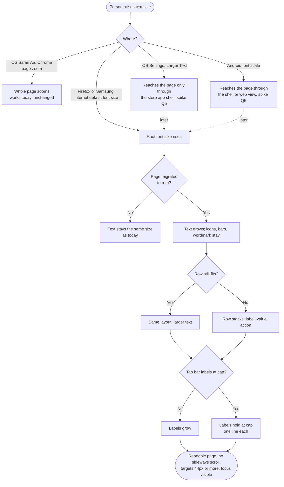
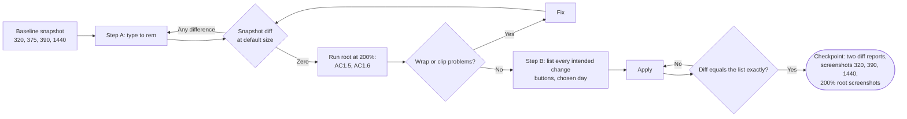
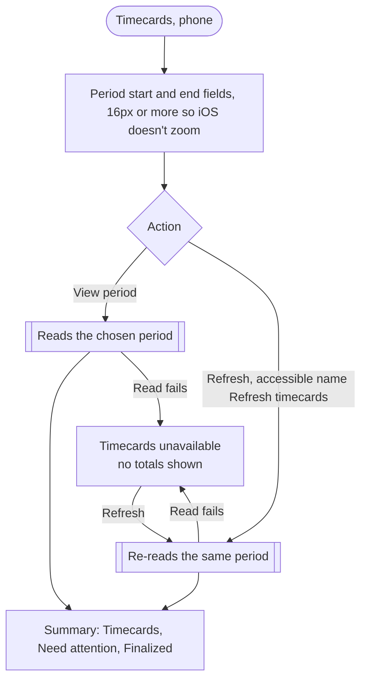
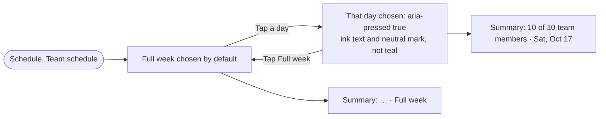

# Phone foundations: flows

- **Initiative:** direction item 8 (A9). PRD: `docs/product/prd-phone-foundations.md`, including "Decisions (Jose, 2026-10-17)": the U10 snapshot script is rebuilt and committed as a dev-only tool, and desktop type stays in `px`.
- **Written:** 2026-10-17 by the UX Designer, cycle 1 design step. The UI Designer's `visual.md` sets the look (the chosen-day style, the tab-label cap value, button styling). This file sets the behaviour: what grows, what wraps, in what order, and what each state shows.
- **Evidence used:** `.claude/evidence/d12/phone-app-timecards.png`, `.claude/evidence/d6/owner-app-schedule-1920.png`, `.claude/evidence/b3/schedule-open-390-opened.png`; `/ui-preview/home` measured live at 390 by 844 (root 16px, tab labels 12px, tab bar 72px tall, Home body text 15px, h1 24px); the code at the paths cited.
- **Not done:** I didn't sign in to the full portal, so Timecards, Schedule and Employees come from screenshots and code. I didn't render a 200% root; the 200% wireframes describe required behaviour, not a measurement.

## Key decisions

1. **What grows and what stays.** At a larger root, **text grows**: body, captions, headings, labels, figures and field text. **These stay fixed:** icons, the NEVORA wordmark, illustrations, the 4px bars, borders and focus rings, and every 44px minimum. A container grows to fit its text, so a button can get taller than 44px but never shorter. People who raise text size want words to read, not a zoomed page; icons and chrome staying put is how iOS Dynamic Type and Android font scale behave (`platform-conventions`).
2. **Wrap, never cut.** When text stops fitting, a row turns from side by side into stacked, in reading order: label first, then value, then action. Nothing truncates with an ellipsis that it didn't truncate at default size (AC1.5). Rows that scroll sideways today (section tabs, the day picker) keep scrolling sideways; they don't wrap into a grid.
3. **The tab bar is the one capped element.** Tab labels grow to a cap, and past it they stay put. Five labels in 64px columns at 320 can't grow freely (PRD Q4). The cap must fit the longest label on one line at 320, **including the Spanish labels B5 will bring** ("Solicitudes", "Horario", "Más"). It must also keep the header and tab bar together under 30% of a 375 by 667 screen. Browser zoom still scales the bar fully, so WCAG 1.4.4 stays met.
4. **Manager Timecards gets the short phone label employees already have.** The employee path renders "Refresh" on phones with the accessible name "Refresh timecards" (`timecards.tsx:156`, `employee-corporate-mobile-copy`). The manager path renders the full "Refresh timecards" text with no short label, which is the two-line pill in `d12/phone-app-timecards.png` (the More tab is lit, so that's the manager view). Apply the same pattern to managers. The accessible name stays exactly "Refresh timecards" (`scripts/phase-d-browser-qa.mjs:66,70,82`).
5. **The chosen day and today are two different marks.** The chosen day says "you're looking at this". Today says "this is the date". Each keeps its own cue, and both can sit on one button. Neither uses teal fill or teal text (P1). The Schedule grid header's solid teal "today" disc breaks the same rule, and the PRD doesn't list it (finding F4).

---

## 1. Flow diagrams

### 1.1 A person with large text opens a page



Release notes must say this (PRD §3): until the shell exists, most iPhone users won't see text grow. The win today is layouts proven to hold large text.

### 1.2 How each page slice is reviewed (team flow)

This is the PRD's zero-diff proof. I draw it because it decides what reviewers see at each checkpoint.



### 1.3 Timecards period (manager and employee, phone)



Both buttons keep their labels, actions and positions (AC2.4). Only shape and line count change.

### 1.4 Choosing a day on the manager Schedule



`aria-pressed`, "Full week", " · Full week" and the 44px targets stay (AC3.3; `manager-weekly-roster.test.tsx:44`).

---

## 2. Wireframes

### 2.1 Timecards period controls, phone

Today, manager at 390 (`d12/phone-app-timecards.png`):

```
┌──────────────────────────────────────┐
│ Period start        Period end       │
│ [10/10/2026  📅]    [10/16/2026  📅] │
│ (  View period  )   (   Refresh    ) │ ← pill, label wraps to
│                     (  timecards   ) │   two lines
│ ⏱ 10 timecards in this period.       │
│ 10 Timecards   10 Need attention     │
│ 0 Finalized                          │ ← orphaned third figure
└──────────────────────────────────────┘
```

After, at 390 and 320 (both roles):

```
┌──────────────────────────────────────┐
│ Period start        Period end       │
│ [10/10/2026  📅]    [10/16/2026  📅] │
│ [  View period  ]   [   Refresh    ] │ ← D4 shape, 44px, one line
│ ⏱ 10 timecards in this period.       │   name stays "Refresh timecards"
│ 10 Timecards · 10 Need attention ·   │
│ 0 Finalized                          │ ← figures wrap as one sentence
└──────────────────────────────────────┘
```

At a 200% root, 390:

```
┌──────────────────────────────────────┐
│ Period start                         │ ← fields stack, one per row
│ [10/10/2026                     📅]  │
│ Period end                           │
│ [10/16/2026                     📅]  │
│ [            View period          ]  │ ← buttons stack, primary first
│ [              Refresh            ]  │
│ ⏱ 10 timecards in this period.       │
│ 10 Timecards                         │
│ 10 Need attention                    │
│ 0 Finalized                          │
└──────────────────────────────────────┘
```

### 2.2 Schedule day picker

Today at 1440 (`d6/owner-app-schedule-1920.png`): "Full week" is a solid teal block; Sat 17 (today) has a teal outline and teal text.

After, at 390 and 1440 (UI Designer sets the exact style):

```
 ┌───────────┐                                  ┌─────┐
 │ Full week │   Mon  Tue  Wed  Thu  Fri        │ Sat │  Sun
 │  (bold)   │   12   13   14   15   16         │ 17  │  18
 └───────────┘                                  │today│
  chosen: ink 600 + neutral fill or border       └─────┘
                                                 today: dot or label, not teal

 Chosen AND today:  ┌─────┐
                    │ Sat │  ← chosen fill + bold, and the today dot
                    │ 17 •│
                    └─────┘
```

At 390 the row scrolls sideways as today (`.mws-day-navigation`, `overflow-x: auto`). At a 200% root the buttons grow taller, and the row keeps scrolling sideways with the chosen day scrolled into view.

### 2.3 Manager Home at a 200% root, 390

```
┌──────────────────────────────────────┐
│ NEVORA                    (⌕) (🔔)   │ header: icons fixed, wordmark fixed
├──────────────────────────────────────┤
│ Home                                 │
│ Northside QA Workforce               │
│ ┌──────────────────────────────────┐ │
│ │ 📅 Scheduled today               │ │ ← tiles go one per row
│ │ 6                                │ │   (order unchanged)
│ ├──────────────────────────────────┤ │
│ │ ⏱ Clocked in now                 │ │
│ │ 4                                │ │
│ ├──────────────────────────────────┤ │
│ │ ⧗ Clocked in after start         │ │
│ │ 1                                │ │
│ ├──────────────────────────────────┤ │
│ │▌⓵ Started, not clocked in        │ │ coral edge kept
│ │ 1                                │ │
│ └──────────────────────────────────┘ │
│ Published shifts only ·              │
│ Updated 10:05 AM                     │
├──────────────────────────────────────┤
│  ⌂      ▦       ✉      ⚇      ⋯     │ icons fixed 22px
│ Home Schedule Inbox  Team   More     │ labels at cap, one line
└──────────────────────────────────────┘
```

Media queries stay in `px` (PRD §6), so the switch to one tile per row can't come from a breakpoint. It has to come from a minimum tile width in `rem`, so the tiles wrap once two no longer fit. That's the UI Engineer's call; the behaviour above is the requirement.

### 2.4 Employee Home next-shift pass at a 200% root, 390

```
┌──────────────────────────────────────┐
│ Next shift              [Published]  │ chip may drop under the heading
│ Tomorrow · Sun,                      │
│ October 18, 2026                     │
│ 8:00 AM –                            │ ← time range breaks after the dash,
│ 4:00 PM                              │   never mid-time
│ [⧗ Starts in 23 h 18 min]            │ pill grows with its text
│ Main Office ·                        │
│ Customer Support                     │
│ ◖- - - - - - - - - - - - - - - - - ◗ │ perforation and notches fixed
│ View schedule                    →   │
└──────────────────────────────────────┘
```

### 2.5 Tab bar label cap (all phone platforms)

```
default (12px)       large root, under cap     large root, past cap
 Schedule             Schedule                  Schedule      ← stays at cap
 ▦ 22px               ▦ 22px                    ▦ 22px          one line
 bar 72px             bar grows with labels     bar stops growing
```

The cap holds Spanish labels too. The header plus tab bar stay under 30% of a 375 by 667 screen. On screens 500px tall or less the header already scrolls away (DESIGN.MD Owed testing), and that rule still applies.

---

## 3. State table

Each migrated page repeats these checks (PRD §5). "Default" means a 16px root; "200% root" means a 32px root at 390.

| State | Default size (390) | 200% root (390) | 200% browser zoom (720 CSS px) and 400% (320 by 256) | Keyboard | Screen reader | Reduced motion |
|---|---|---|---|---|---|---|
| **Loading** | Route skeletons (`route-skeleton.tsx`) and Home's "Loading Home…" lines unchanged | Skeleton bars keep their shape; caption text grows; nothing overlaps | 81-view zoom run still passes | No change | "Loading [section]…" via `role="status"` | Skeletons static (already) |
| **Empty** | `EmptyState` unchanged | Title and description wrap; illustration keeps its size | Same | Action button reachable | Unchanged | No change |
| **Error** | "Unavailable" notices, Retry buttons | Notice wraps; Retry stacks under the text; never a 0 | Same | Retry reachable | Notice is read | No change |
| **Offline** | `fuel-portal-offline.html` is outside app CSS; "Try again" takes the D4 shape in slice 1 | The offline page's own `px` stays (it isn't an app page) | Same | "Try again" focusable | Unchanged | No change |
| **Partial** (some sources unknown, e.g. "Some Home sections could not be fully checked…") | Unchanged text (script-pinned, U5) | Notice wraps fully, no clamp | Same | No change | Read once | No change |
| **Success** (toasts, "Approval recorded", publish panel) | Unchanged | Toast grows with its text and stays above the tab bar | Same | Toast dismiss reachable | `role="status"` | No change |
| **Permission denied** ("Task access ended", "Sign in again to view Home.") | Unchanged | Wraps | Same | Sign-in link reachable | Read | No change |
| **Buttons** | D4 shape: 8px corners, 44px or taller | Height grows with the label; labels wrap only where they wrapped at 390 by default | Same | Focus ring visible, clear of sticky chrome (`scroll-padding-block`, `portal-gusto.css:306`) | Names unchanged | Press scale off (already) |
| **Day picker** | Chosen: no teal (AC3.1); today mark separate | Buttons taller; row scrolls sideways; chosen day kept in view | Same | Arrow keys not added; Tab moves through days as today | `aria-pressed` read as "selected" or "pressed" | Colour transition (`.18s`, `manager-schedule.css:50`) off |
| **Tab bar** | 12px labels (measured) | Labels at cap; bar height capped | Scales fully with zoom | Unchanged | "Schedule, tab, selected" (or link equivalent) | No change |
| **Forced colours, more contrast** | Existing rules apply | Same | Same | Ring visible | n/a | n/a |

The chosen day keeps a visible border in forced colours (PRD §5).

**Per platform.**

| Platform | What changes now | Back, keyboard, safe areas |
|---|---|---|
| iOS Safari tab | Nothing visible at default. "Aa" zoom keeps working | No change |
| iOS PWA | Layouts ready. Text grows only once the shell passes the OS setting | No change |
| Android Chrome tab, Android PWA | Same as iOS for the OS font scale. Firefox and Samsung Internet users with a larger default font size see text grow on migrated pages | No change |
| Store apps (later) | The shell maps Dynamic Type or the font scale to the root size, and this work gives it something to scale | Spike question 5 |
| Desktop web | No change at any setting (Decision Q2) | U10 snapshot shows zero differences at 1440 |

---

## 4. Usability findings on the current version

| # | Finding | Heuristic | Severity | Evidence | Fix |
|---|---|---|---|---|---|
| F1 | Phone text ignores the reader's text size. Low-vision users have to pinch-zoom, which brings sideways scrolling back | Accessibility (WCAG 1.4.4 met by zoom only); flexibility | 3 | About 2,430 `px` font declarations vs 56 `rem` in `src/` (PRD §2); phone tokens fixed in `mobile-workforce.css:13-38`; root 16px and labels 12px measured live | This initiative, page by page |
| F2 | Manager Timecards: "Refresh timecards" wraps to two lines in a pill beside a teal pill, so the pair looks unbalanced and the secondary reads as heavier | Consistency; aesthetic and minimalist | 2 | `d12/phone-app-timecards.png`; `timecards.tsx:156` gives only the employee (`corporate`) path a short label | Decision 4 |
| F3 | The chosen day uses solid teal, the colour that means "act here". "Full week" looks like a primary button you still need to press | Consistency (P1) | 2 | `d6/owner-app-schedule-1920.png`; `manager-schedule.css:55` (`button.selected { background: var(--design-primary) }`) | S3 |
| F4 | The Schedule grid header marks today with a solid teal disc and teal "Today" text, both non-interactive. The P1 inventory will flag them, and S3 doesn't cover them | Consistency (P1) | 2 | `manager-schedule.css:65` (`.mws-grid-heading .today strong { background: var(--design-primary) }`) and `:64` (`.mws-grid-heading small { color: var(--design-accent-ink) }`); Sat 17 in `d6/owner-app-schedule-1920.png` | Add to slice 6 (open question P1) |
| F5 | Timecards summary figures wrap with "0 Finalized" alone on the second line, which reads as a separate item | Scanning | 1 | `d12/phone-app-timecards.png` | Let the three figures wrap as one line of text (2.1) |
| F6 | "Review selected timecards" shows a "0 selected ›" pill. Its chevron suggests it opens something, but with nothing selected there is nothing to review | Affordance; error prevention | 2 | `d12/phone-app-timecards.png`; `timecards.tsx:163-165` (a `details` that opens only once something is selected) | Out of this PRD's scope (copy and behaviour). Flag for the Timecards page slice (P2) |
| F7 | Phone tab label size depends on which legacy rule wins: 9px (`globals.css:650`), 10px (`globals.css:11517`, `portal-design-system.css:70`) or 12px (`mobile-workforce.css:91`). I measured 12px on Home, but the cascade is fragile | Consistency | 2 | The rules cited | Slice 1 sets one tab label token in `rem` inside the phone query, then caps it |
| F8 | Phone menu items are 48px tall while D4 buttons are 44px (PRD Q6). People don't notice the mismatch, but it makes the inventory noisy | Consistency | 1 | PRD Q6; `portal-gusto.css:300` (`.employee-more-link { min-height: 48px }`) | Keep 48px for list rows (they're rows, not buttons) and 44px for buttons |

---

## 5. Open questions

### For the UI Designer

| # | Question | My recommendation |
|---|---|---|
| V1 | What is the tab label cap (decision 3)? | Whatever fits "Solicitudes" on one line in a 64px column at 320, about 1.15× today's 12px. The cap is a `rem` clamp |
| V2 | Chosen-day style: neutral fill with ink 600, or a bottom border? It needs two cues and 3:1 against unchosen (AC3.2) | Neutral fill (`--g-inset`) plus ink 600, matching the D4 segmented control's chosen state, so people see one selection language |
| V3 | Today marker without teal: a dot, or "Today" text in muted ink? | A small ink dot under the date on the picker; "Today" in muted ink in the grid header, with the disc removed |
| V4 | "Close actions" pill on More sheets (PRD Q5) | Keep the pill. It's a sheet dismiss control, listed as an exception |

### For the PM

| # | Question | My recommendation |
|---|---|---|
| P1 | Add the grid header's teal "today" disc and "Today" text (F4) to slice 6? AC3.4 only checks the day picker, so the P1 inventory would still fail on Schedule | Yes, same slice, same reason |
| P2 | F6 ("0 selected ›") isn't a type or shape problem. Log it for a later Timecards pass? | Yes. Don't widen this PRD |
| P3 | Manager Timecards short label (decision 4) changes visible text on phones from "Refresh timecards" to "Refresh". Accept it as a step B intended change? | Yes. The accessible name stays exact and the pattern already ships for employees |
