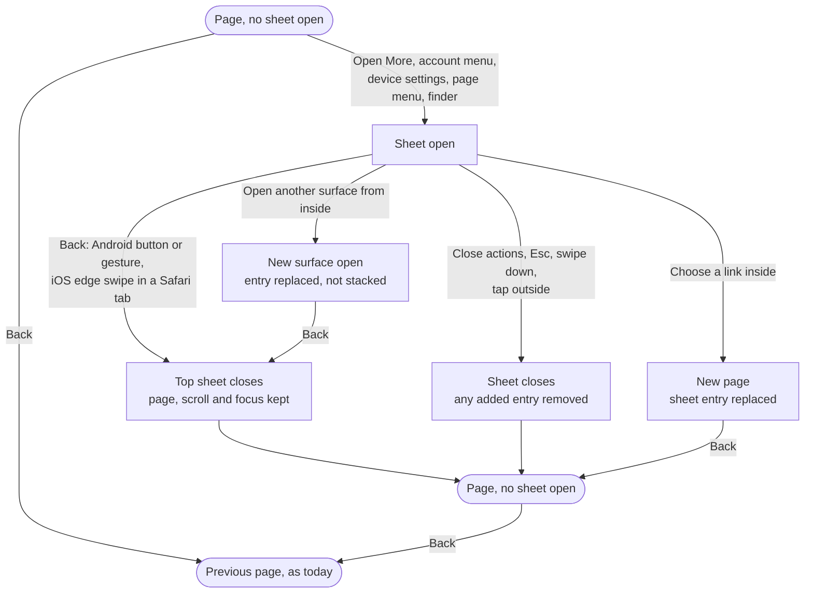
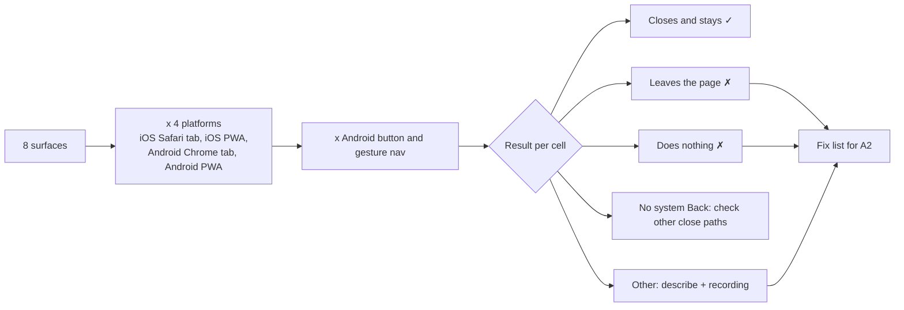
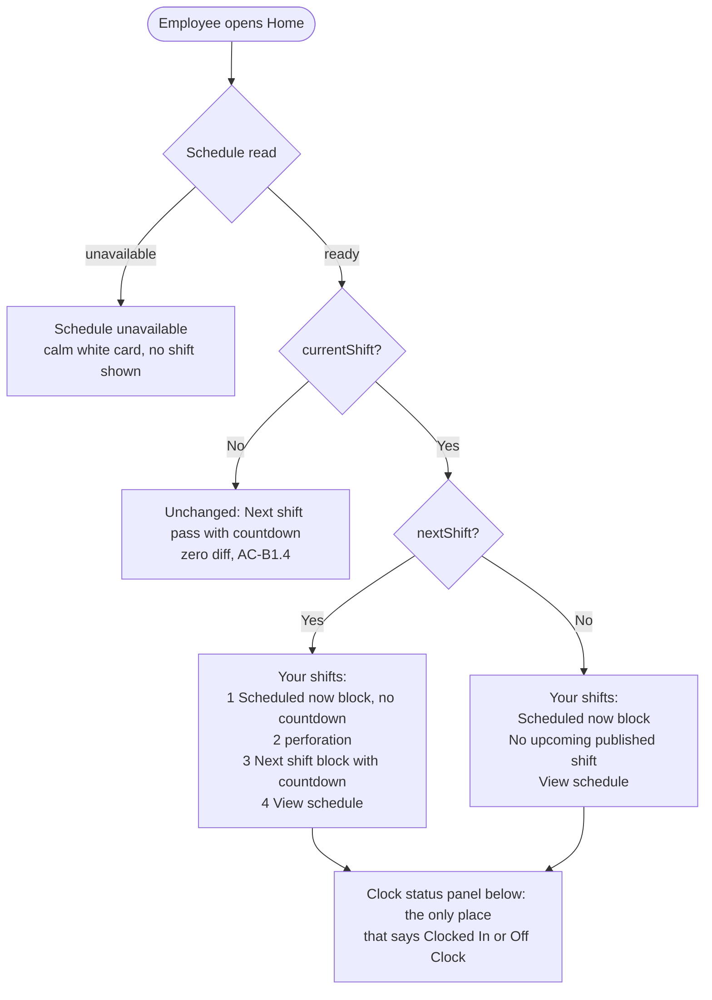
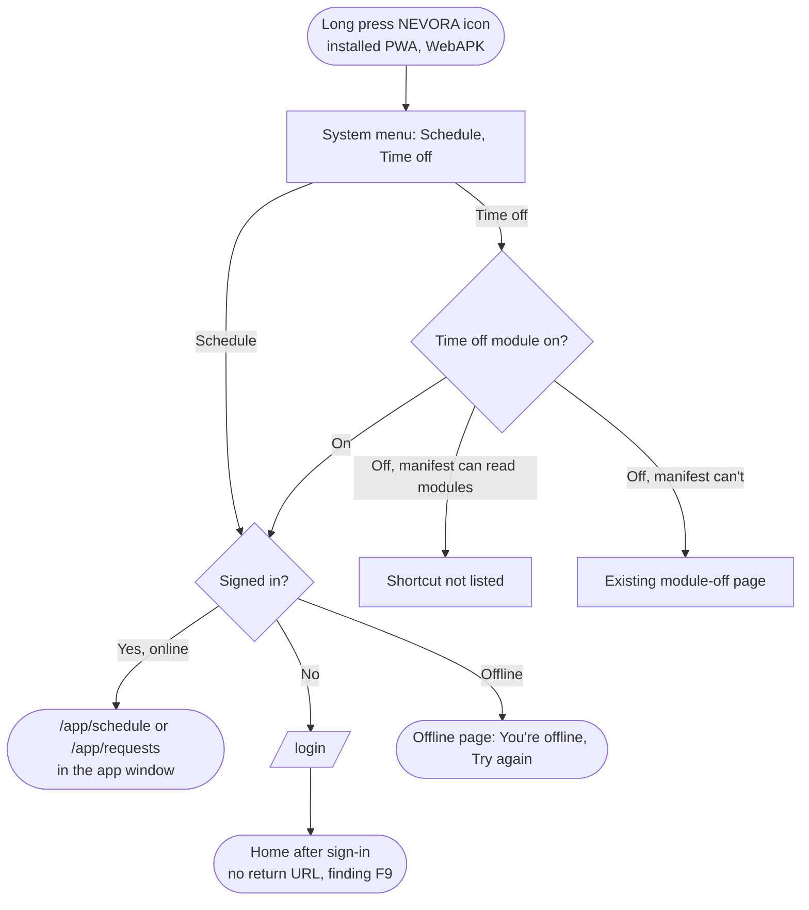

# Phone polish: flows

- **Initiative:** direction items 11 (A17, Back closes sheets), 12 (small fixes) and 13 (A13, Android icon shortcuts). PRD: `docs/product/prd-phone-polish.md`. It has no Jose decisions section yet.
- **Written:** 2026-10-17 by the UX Designer, cycle 1 design step. The UI Designer's `visual.md` covers the look.
- **Evidence used:** `.claude/evidence/errors/employee-home-1440.png` (tomorrow's shift above "Scheduled now"); `/ui-preview/home` checked live at 390 by 844 and at desktop width as Owner and Employee: the More sheet opened, Esc closed it and returned focus to "More navigation", and the history length stayed the same. Also the code at the paths cited.
- **Not done:** no device or simulator run, so the Back matrix is empty by design (slice A1 fills it). No portal sign-in.
- **References:** NN/g and Android Back expectations (T §4); HIG sheets; Future Pro home (U2's reference) for one coloured card leading Home ([mobbin](https://mobbin.com/screens/2b5839c4-0519-4df7-9341-bd7fd3a0f60b)).

## Key decisions

**Part A, Back closes sheets**

1. **One surface at a time, one history entry at most.** NEVORA's sheets are `popover="auto"` and modal `<dialog>`s, so opening one closes any other auto popover. If a fix adds a history entry (PRD Q1, iOS), it adds exactly one per open surface. Moving from one surface to another (More › Search, account menu › "Profile and device settings") **replaces** that entry and never stacks a second one.
2. **A link inside a sheet replaces the sheet's entry.** Without this, the stack ends up as `[page, page+sheet, new page]`. Back from the new page lands on `page+sheet`, which looks exactly like `page`, and the next Back seems to do nothing. With replacement the stack is `[page, new page]`, which meets AC-A2.3 and AC-A2.4.
3. **Phone layout only.** Any history entry is added only under the phone chrome query (`portal-gusto.css:284`). Desktop keeps Esc and today's browser Back (AC-A2.5's "otherwise" branch). Desktop people don't expect Back to close a menu, and nobody has reported a problem there.
4. **"No system Back" is a valid result.** iOS Home Screen web apps don't offer a back swipe of their own (to confirm in A1). There, record the cell as "no system Back" and check that "Close actions", swipe down and Esc still work. Don't build a gesture to stand in for it.

**Part B, small fixes**

5. **With a shift under way, the card leads with it.** The card heading becomes "Your shifts", and "Next shift" moves down to label the future block. See 2.1 for why every script and test contract still holds. If the PM keeps the heading "Next shift" (PRD Q2), the fallback layout is in 2.1 too.
6. **One "View schedule" link per card.** Today a card with both shifts shows two identical "View schedule" links to the same page (`employee-home-1440.png`). Reordering is the moment to keep a single one at the end of the card (open question P2).

**Part C, shortcuts**

7. **Shortcut labels are the existing navigation names**, "Schedule" and "Time off", in that order. Nothing new for people to learn.

---

## 1. Flow diagrams

### 1.1 Back on a phone (target behaviour)



### 1.2 History stack, step by step (only if A1 shows a fix is needed)

```
Step                                   History stack (top on the right)      Screen
1  On Schedule                         [Home, Schedule]                       Schedule
2  Open More                           [Home, Schedule, Schedule·sheet]       More open
3a Back                                [Home, Schedule]                       Schedule, More closed   ✓
3b "Close actions" instead             [Home, Schedule]  (entry removed)      Schedule                ✓
3c Tap "Timecards" in More instead     [Home, Schedule, Timecards]            Timecards  (replaced)   ✓
   then Back                           [Home, Schedule]                       Schedule, More closed   ✓
3d Tap "Search" in More instead        [Home, Schedule, Schedule·sheet]       Finder (entry reused)   ✓
   then Back                           [Home, Schedule]                       Schedule                ✓
4  Reload with a sheet open            [Home, Schedule]                       Schedule, no sheet (AC-A2.6)
```

Wrong outcomes to test for, each one a failing cell:
- Back leaves the page with the sheet open (today's likely iOS Safari result, T §4).
- Back needs two presses after closing a sheet another way (an entry left behind).
- Back from a page opened inside a sheet lands on an identical-looking page (an entry not replaced).
- The Employees search history replacement (U8) or D6 row navigation changes (AC-A2.7).

### 1.3 Measuring first (slice A1)



### 1.4 Employee Home with a shift under way



### 1.5 Android icon shortcut



Roles: Schedule serves both roles. `/app/requests` is an employee's own Time off tab and a manager's review page (`requests/page.tsx:49`). On phones it lights the employee Requests tab or the manager Inbox tab (`mobileTabsForRole`, `navigation.ts:147,152`).

---

## 2. Wireframes

### 2.1 Employee Home card with a shift under way (390; desktop 1440 uses the same order in the left column)

Today (`employee-home-1440.png`):

```
┌ Next shift ─────────────────── Published ┐
│ Tomorrow · Sun, October 18, 2026         │
│ 8:00 AM – 4:00 PM                        │
│ [⧗ Starts in 23 h 18 min]                │
│ Main Office · Customer Support           │
│ ◖ - - - - - - - - - - - - - - - - - - - ◗│
│ View schedule                         →  │
│ Times in Puerto Rico time                │
│ ──────────────────────────────────────── │
│ Scheduled now                            │
│ Scheduled assignment; clock status is    │ ← audit language (B2)
│ shown separately.                        │
│ Sat, October 17, 2026                    │
│ 8:00 AM – 4:00 PM                        │
│ Main Office · Customer Support           │
│ View schedule                         →  │ ← second identical link
│ Times in Puerto Rico time                │
│ Some of your locations haven't published │
│ this week yet. The shifts shown are …    │
└──────────────────────────────────────────┘
```

After (recommended):

```
┌ Your shifts  (h2, id employee-reviewed-next-heading) ── Published ┐
│ Scheduled now                       (h3, exact text, once)        │
│ Clock status below shows if you're clocked in.                    │
│ Today · Sat, October 17, 2026                                     │
│ 8:00 AM – 4:00 PM                    no countdown (U2)            │
│ Main Office · Customer Support                                    │
│ ◖ - - - - - - - - - - - - - - - - - - - - - - - - - - - - - - - ◗ │
│ Next shift                          (h3)                          │
│ Tomorrow · Sun, October 18, 2026                                  │
│ 8:00 AM – 4:00 PM                                                 │
│ [⧗ Starts in 23 h 18 min]            countdown on the future only │
│ Main Office · Customer Support                                    │
│ View schedule                                                  →  │ ← one link
│ Times in Puerto Rico time                                         │
│ Some of your locations haven't published this week yet. …         │
└───────────────────────────────────────────────────────────────────┘
┌ Clock status ─────────────────────────────────────── Off Clock ──┐
```

The contracts still hold:

| Contract | Source | Holds? |
|---|---|---|
| Card keeps `aria-labelledby="employee-reviewed-next-heading"` | `scripts/phase-e-home-browser-scenarios.mjs:18` | Yes: the h2 keeps its id; only its text changes in this one state |
| "Scheduled now" exact text, visible inside the card | `phase-e…mjs:41` (H01) | Yes: once, as the h3. Never use it as the h2 too, or `getByText(…, {exact:true})` matches twice |
| "Next shift" text inside the card, before the own-time slot | `employee-home-reviewed.test.tsx:116` | Yes: as the future block's h3 |
| Card before To do | `phase-e…mjs:42`; DESIGN.MD U2 | Yes |
| No "Clocked In" in the card | `employee-home-clock.test.tsx:15` | Yes |
| Countdown only on a future shift | U2 | Yes |
| No current shift: zero diff | AC-B1.4 | Yes: the heading reads "Next shift" as today |

H01's check *label* says "persisted future Next Shift leads" (`phase-e…mjs:44`). It's a description, not an assertion, but it becomes untrue. Update the label in the same commit.

**Fallback if the heading must stay "Next shift"** (PRD Q2): keep the h2 "Next shift" and put a "Scheduled now" block first under it, but then the first thing under "Next shift" is a shift that isn't next. That's the confusion B1 exists to fix, so I recommend against it.

Today vs tomorrow wording: the current block should lead its date with "Today", as the next block leads with "Tomorrow" (U2: "Today" or "Tomorrow" leads the date). Today the current block shows the bare date (`employee-home-1440.png`).

Overnight shift under way (started yesterday): "Scheduled now" shows both dates, as the clock test already covers (`employee-home-clock.test.tsx:15`).

### 2.2 B2 copy

| Old (`employee-home-reviewed.tsx:265`) | PRD suggestion | Recommended |
|---|---|---|
| "Scheduled assignment; clock status is shown separately." | "This is your schedule. Clock status shows whether you've clocked in." | "Clock status below shows if you're clocked in." |

The Clock status panel sits below the card at 390 and at 1440 (the `recordedSlot` aside follows the card in `.primary`), so "below" is true at both widths. Shorter, and it names the panel by its heading. Tests `employee-home-clock.test.tsx:15` (`clock status is shown separately`) and `employee-home-reviewed.test.tsx:114` move to the new wording in the same commit.

### 2.3 Back matrix (the A1 deliverable)

```
| Surface                          | iOS Safari tab | iOS PWA | Android Chrome (btn) | Android Chrome (gesture) | Android PWA (btn) | Android PWA (gesture) |
|----------------------------------|----------------|---------|----------------------|--------------------------|-------------------|-----------------------|
| Employee More sheet              |                |         |                      |                          |                   |                       |
| Manager More menu                |                |         |                      |                          |                   |                       |
| Account menu (desktop only?) *   |                |         |                      |                          |                   |                       |
| Profile and device settings      |                |         |                      |                          |                   |                       |
| Schedule page menu               |                |         |                      |                          |                   |                       |
| Locations page menu              |                |         |                      |                          |                   |                       |
| Issue focus popover              |                |         |                      |                          |                   |                       |
| Clocker admin dialogs            |                |         |                      |                          |                   |                       |
| Finder sheet (after phone search)|                |         |                      |                          |                   |                       |
Cell values: ✓ closes and stays · ✗ leaves page · ✗ nothing · NB no system Back (then: Close actions ✓/✗, swipe down ✓/✗) · ? other (describe)
Each cell links a screenshot or recording.
```

\* Phones hide the account menu (`portal-gusto.css:180`), so it isn't reachable at phone width. It appears in landscape today (phone-search finding F4). Record it as "not reachable" in portrait.

Repeat one surface per platform at 200% zoom (PRD §5).

### 2.4 Preview sidebar (B3), desktop 1440

```
Today, Owner (measured live, 14)       After, Owner with fictional payroll flags (10, D3)
Plan                                   Plan
  Home                                   Home          (lit)
  Inbox                                  Inbox
  Schedule                               Schedule
  Availability          ✗              Team
  Shift requests        ✗                Employees
  Templates             ✗                Requests
Team                                     Updates
  Employees                            Time & Pay
  Time off              → Requests       Timecards
  Updates                                Payroll
Time & Pay                               Insights
  Timecards                            Workspace
  Payroll export        ✗                Settings
  Insights
Workspace
  Settings
  Scheduling rules      ✗

Employee today: Home, My schedule, My time, Requests, Availability ✗, Updates, Notifications, Profile ✗
Employee after: Home, My schedule, My time, Requests, Updates, Notifications (+ My pay with payroll)
```

The phone tab bar and More in the preview don't change; they already come from `mobileTabsForRole()` and `mobileMoreForRole()` (`home-preview.tsx:35-36`).

### 2.5 Preview figures agree (B4), Owner at 390

```
Today (live)                               After
Scheduled today 6 · Clocked in now 4       Scheduled today 6 · Clocked in now 4
Published shifts only · Updated 10:05 AM   Published shifts only · Updated 4:49 PM   ← same frozen time
Tasks · Updated 4:49 PM                    Tasks · Updated 4:49 PM
Clocked in now                             Clocked in now
  No one is clocked in right now   ✗         Alexandra Rivera · Main Office · 8:00 AM   ← 4 fictional rows
  Updated 4:49 PM                            …
                                             Updated 4:49 PM
```

Measured live: the Today strip reads "Updated 10:05 AM" (from `previewToday.observedAt`, dated 2030-10-16, `home-preview.tsx:15`), while Tasks and the rail read "Updated 4:49 PM". One frozen time for all three (AC-B4.2). If the fixture shows zero clocked in instead, the rail hides its empty card, as live D3 Home does (AC-B4.3).

### 2.6 Android long-press menu (Android PWA)

```
        ┌──────────────────────┐
        │ ▦  Schedule          │  96px Phosphor glyph, purpose "any"
        │ ✈  Time off          │  (✈ stands for the NavIcon timeOff glyph)
        ├──────────────────────┤
        │ ⓘ  App info          │  system rows
        └──────────────────────┘
            [ NEVORA icon ]
```

Desktop Chrome and Edge (installed) list the same two in the Dock or taskbar menu. iOS ignores `shortcuts`; nothing to design there until the store build.

---

## 3. State table

| State | A. Back | B1, B2. Employee Home | B3, B4. Preview | C. Shortcuts |
|---|---|---|---|---|
| **Loading** | Back during a route skeleton with a sheet open closes the sheet only | "Loading Home…" unchanged (script-pinned) | Unchanged | Opens the route skeleton |
| **Empty** | No sheet open: Back navigates as today | No current shift: unchanged (zero diff). Current shift, no next: "Scheduled now" then "No upcoming published shift" | n/a | n/a |
| **Error** | n/a | "Schedule unavailable": no shift shown, calm white card | n/a | Route error page as today |
| **Offline** | Back still closes sheets (no network) | Paused Home: "Home paused — return online to refresh." unchanged | n/a | Offline page |
| **Partial** | n/a | Publication note stays at the card's end ("Some of your locations haven't published this week yet…") | n/a | n/a |
| **Success** | Sheet closed, page kept, focus on opener | Shift under way leads; one "View schedule" | Sidebar and figures match live rules | Page opens in the app window |
| **Permission denied** | n/a | "Sign in again to view Home." unchanged | n/a | Signed out: `/login`, then Home (no return URL) |
| **Reduced motion** | Close after Back uses the existing close transition, which reduced motion already shortens (Phase 3) | No new motion; countdown text still updates each minute | n/a | n/a |
| **Keyboard** | Esc closes; focus returns to the opener | Reading order matches visual order: Scheduled now, Next shift, View schedule | Sidebar tab order follows the 10-entry list | n/a |
| **Screen reader** | VoiceOver's two-finger scrub (Z gesture) still closes More (Owed testing script, step 3) | h2 "Your shifts", h3 "Scheduled now", h3 "Next shift"; countdown skipped, as today | Landmarks unchanged | System menu |
| **200% zoom** | Matrix repeated at 200% on one surface per platform | Both blocks wrap; times break after the dash; no clipping at 320 | Sidebar wraps or scrolls as live does | n/a |

**Per platform (Part A).**

| Platform | Expected today (to verify in A1) | Fix if it fails |
|---|---|---|
| Android Chrome tab and Android PWA | Back is a close request for open `popover="auto"` and modal dialogs, so sheets likely close | None if ✓ |
| iOS Safari tab | The edge swipe walks history and likely leaves the page | One history entry while a sheet is open (decisions 1 to 3), phone layout only |
| iOS PWA | Likely no system back gesture | Record "NB"; check Close actions, swipe down |
| Desktop web | Esc closes; Back navigates | No change (decision 3) |
| Store apps | Spike question 6 (`backButton` in Capacitor, WKWebView swipe) | The shell |

---

## 4. Usability findings on the current version

| # | Finding | Heuristic | Severity | Evidence | Fix |
|---|---|---|---|---|---|
| F1 | With a shift under way, Home leads with tomorrow's shift and its countdown. At a glance the person at work sees "8:00 AM – 4:00 PM, Starts in 23 h" first | Match with the real world; visibility of status | 3 | `employee-home-1440.png`; `employee-home-reviewed.tsx:260-267` (next first, current after) | B1, decision 5 |
| F2 | "Scheduled assignment; clock status is shown separately." reads as audit language | Match with the real world | 2 | `employee-home-reviewed.tsx:265` | B2 |
| F3 | Two identical "View schedule" links and two "Times in Puerto Rico time" lines in one card | Aesthetic and minimalist; WCAG 2.4.4 link purpose (same name, same target is allowed, but it's noise in a links list) | 2 | `employee-home-1440.png` | Decision 6 |
| F4 | The current block shows a bare date, while the next block leads with "Tomorrow". The shift that's happening now is the one without a relative day | Consistency | 2 | `employee-home-1440.png` ("Sat, October 17, 2026" vs "Tomorrow · Sun, October 18, 2026") | Lead with "Today" (2.1) |
| F5 | Nobody has checked Back against any sheet on a device. On iOS Safari, an edge swipe with More open probably leaves the page | User control and freedom | 3 (unverified) | `app-shell.tsx:265-268` (`popover="auto"`, no history handling); T §4; direction "Not verified" | Part A |
| F6 | The preview sidebar shows 14 Owner entries (pre-D3) and 8 for employees; reviewers flag problems that are already fixed | Consistency (reviewer trust) | 2 | Live: `.sidebar-nav a` lists Availability, Shift requests, Templates, Time off, Payroll export, Scheduling rules; `home-preview.tsx:33,47` | B3 |
| F7 | Preview figures disagree: Today strip "Clocked in now 4", rail "No one is clocked in right now", and two different "Updated" times on one screen (10:05 AM vs 4:49 PM) | Consistency; visibility of status | 2 | Live at 390; `home-preview.tsx:15-16`; `home-fixtures.ts:33-35` | B4 |
| F8 | The employee preview has no shift under way, so reviewers can't check B1 in the preview | Visibility | 1 | Live: the card text has no "Scheduled now"; `previewEmployeeHome` | Open question P3 |
| F9 | A signed-out person who taps the Time off shortcut lands on Home after sign-in, not on Time off | User control | 2 | `src/lib/auth/session.ts:113`; PRD AC-C8 | Out of scope (auth); log with the passkey phase |

---

## 5. Open questions

### For the PM

| # | Question | My recommendation |
|---|---|---|
| P1 | PRD Q2: may the card's h2 read "Your shifts" while a shift is under way (2.1)? The id, "Scheduled now", "Next shift" and order contracts all hold; only H01's description label changes | Yes. It removes the contradiction B1 exists to fix |
| P2 | Decision 6: keep one "View schedule" per card? Both go to `/app/schedule`; H08 only counts links after leaving Home, so it isn't affected | Yes, one link at the card's end |
| P3 | Add a fictional current shift to the employee preview, or a second employee sample, so reviewers can see B1? | Yes, as part of B2 (preview fixes). The preview privacy test still applies |
| P4 | PRD Q1: if iOS fails in A1, may the fix add one history entry per open sheet, phone layout only, with decisions 1 to 3? | Yes. If the App Router fights it, ship Android-only fixes and record iOS as a known gap for the shell (the PRD's fallback) |

### For the UI Designer

| # | Question | My recommendation |
|---|---|---|
| V1 | In the reordered card, does the perforated stub sit between the two blocks, and does the pass treatment cover both? | Yes: one pass, one stub between now and next, so the card stays the single brand moment (U2) |
| V2 | Shortcut icons: which glyphs? | The `NavIcon` schedule and timeOff glyphs (PRD AC-C4), drawn locally, no paid generation |
