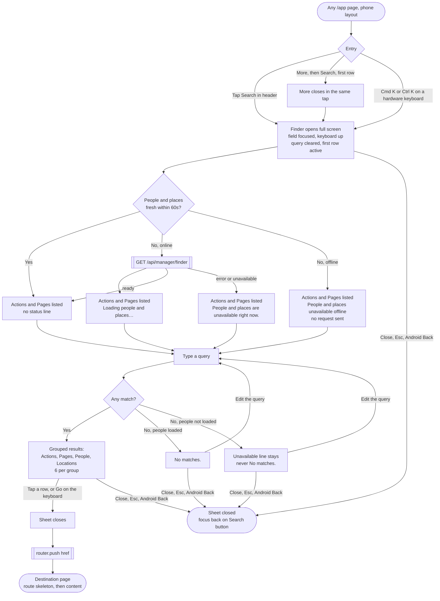
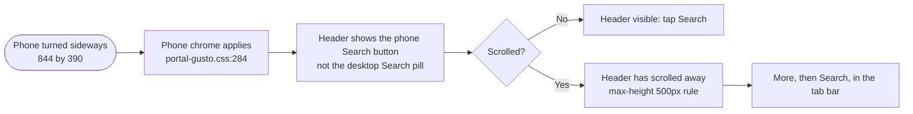

# Phone search: flows

- **Initiative:** direction item 6 (A8). PRD: `docs/product/prd-phone-search.md`.
- **Written:** 2026-10-17 by the UX Designer, cycle 1 design step. The UI Designer's `visual.md` covers the look; this file covers how it works.
- **Evidence used:** the code at the paths cited; `/ui-preview/home` viewed live at 390 by 844 and at desktop width (Owner, Manager, Employee); screenshots in `.claude/evidence/`. I did not sign in to the full portal, so I didn't open the live ⌘K dialog. Its behaviour comes from `src/components/command-finder.tsx` and DESIGN.MD U8.
- **References:** Shopify iOS search with its close control ([mobbin](https://mobbin.com/screens/904d082d-43f9-44c5-b3ed-97d26af9bad2)); field on top with "Cancel" in Doji ([mobbin](https://mobbin.com/screens/fd8585fa-c7bf-4eac-b5c8-4a97fff09c00)), Perplexity, with an in-field clear button ([mobbin](https://mobbin.com/screens/b27ec646-8b6f-4dbb-9f5e-54e759155016)), and Fly Delta ([mobbin](https://mobbin.com/screens/c2935380-ee25-4ad2-bb0e-937315160fb7)). All of them put the field at the top with the keyboard up, which supports PRD Q1.

## Key decisions

1. **One dialog, three ways in.** The header button, More › Search and ⌘K all call the same `open()` on the single `<dialog>` in `command-finder.tsx`. The phone gets no second search component.
2. **The finder must open inside the tap that asks for it.** iOS raises the keyboard only when focus moves during a user gesture. More › Search therefore hides the More popover and calls `open()` in the same click handler, with no wait for More's 110ms close transition. If the finder opens after a timer, the field gets focus but no keyboard appears on iOS Safari or in the iOS PWA.
3. **On phones, the status line moves up to sit under the field.** Today it renders after the list (`command-finder.tsx:88`, grid row 3 of `.command-finder-panel`). With the keyboard up, that row lands under the keyboard, and you'd miss "People and places are unavailable right now." while typing a name.
4. **The status line follows a fixed order of precedence.** Offline, then unavailable, then loading, then "No matches." Today "No matches." wins over unavailable (`command-finder.tsx:89`). That breaks AC4.4 on desktop already (finding F2).
5. **Nothing new in the navigation data.** "Search" is a button the shell draws. `navigationForRole()`, `mobileTabsForRole()` and `mobileMoreForRole()` don't change (AC3.3).

---

## 1. Flow diagrams

### 1.1 Open, search, go (Owner or manager, phone layout)



### 1.2 Close paths and focus return

| How the person closes | What happens | Focus goes to |
|---|---|---|
| Tap "Close" | `dialog.close()` | The control that opened it: the header Search button, or the More button if opened from More (More is gone by then) |
| Esc (hardware keyboard) | Native dialog cancel | Same |
| Android Back (button or gesture) | Chromium treats Back as a close request for a modal dialog | Same; the page stays. To verify in the phone-polish Back matrix |
| iOS edge swipe in a Safari tab | Today it walks history and leaves the page. Fixed by phone-polish Part A | Same, once fixed |
| Tap the backdrop | Not available: the phone sheet fills the screen, so there is no backdrop | n/a |
| Choose a result | Closes, then navigates | The new page's focus rules |
| Swipe down | **Not offered.** `sheet-gestures.tsx` handles `[popover]` sheets only, and a full-screen search page has no grab handle in iOS or Android search screens | n/a |

When the finder opens from More, focus can't return to the Search row because More has closed. Return it to the More button, which is where the person last was in the tab bar.

### 1.3 Landscape and short screens



On screens 500px tall or less the header scrolls away (DESIGN.MD Owed testing). The tab bar stays, so More › Search is the always-reachable entry in landscape and at 400% zoom. Landscape users need slice 2 to reach search after scrolling.

### 1.4 Information architecture

```
Global (every /app page, Owner and manager only)
├── Phone header ........ [Search] [Bell]            (account actions stay in More)
├── Phone tab bar ....... Home · Schedule · Inbox · Team · More
│                                                    └── More: Search (new, first) · Updates · Timecards ·
│                                                        Insights · Payroll export · Templates ·
│                                                        Scheduling rules · Settings · Profile and device
│                                                        settings · Sign out · Close actions
└── Desktop top bar ..... [Search ⌘K] [Bell] [Account menu]   (unchanged)

Finder contents (finder.ts, unchanged)
├── Actions ...... Add a shift · Add an employee (or "Add <person word>") · Send an update
├── Pages ........ every navigationForRole() entry (empty query: first 6 only)
├── People ....... typed queries only, from /api/manager/finder
└── Locations .... typed queries only; opens /app/schedule?location=<id>
```

More list order measured live in the Owner preview at 390: Updates, Timecards, Insights, Payroll export, Templates, Scheduling rules, Settings, then Close actions. The live shell adds "Profile and device settings" and "Sign out" (`app-shell.tsx:330-332`). With Search first, More holds up to 12 rows for an Owner with payroll. That's fine for a list the person scans once; Search sits at the top, nearest the eye, and the sheet is anchored at the bottom, so it's a short reach from the More button.

---

## 2. Wireframes

Low fidelity. Labels are real; sizes are targets, not visual decisions.

### 2.1 Phone header, closed (390, all phone platforms)

```
┌──────────────────────────────────────────────┐
│ NEVORA            [logo]        (⌕)   (🔔)   │  masthead, 44px targets
│ Workforce                                    │  ⌕ = Phosphor MagnifyingGlass
└──────────────────────────────────────────────┘     name "Search", aria-haspopup="dialog"
```

Order, left to right: wordmark, company logo chip (B1, optional), Search, bell. Search sits left of the bell so the bell keeps its familiar far-right place (continuity). Employees and leads see no Search (`app-shell.tsx:222`).

### 2.2 Phone header at 320 with a logo chip and a bell count

```
┌────────────────────────────────────┐
│ NEVORA   [logo]      (⌕)  (🔔²)    │
└────────────────────────────────────┘
```

Rough budget at 320: 16 gutter + wordmark about 137 + 10 + chip up to 88 + 8 + 44 + 8 + 44 + 16 = **about 371px**, which is over 320. Today it fits only because there's no Search button. Something has to give, and the UI Designer decides what (open question V1). From a flow point of view: the wordmark and both targets must stay whole. The chip is the only element that can shrink or hide.

### 2.3 Search sheet, empty query (iOS Safari, iOS PWA, Android Chrome, Android PWA)

```
┌──────────────────────────────────────────────┐ ← top safe area (status bar in PWA)
│ ⌕ [Search pages, people and places ] [Close] │ field 17px, Close 44px, text label
│ Loading people and places…                   │ status line HERE on phones (role=status)
├──────────────────────────────────────────────┤
│ ACTIONS                                      │
│ ▌Add a shift                                 │ row 1 active: the keyboard's Go key opens it
│  Add an employee                             │ rows ≥ 44px
│  Send an update                              │
│ PAGES                                        │
│  Home                                        │
│  Inbox                                       │
│  Schedule                                    │
│  Availability                                │
│  Time off                                    │
│  Shift requests                              │
├──────────────────────────────────────────────┤
│ q w e r t y u i o p                          │ keyboard: list scrolls behind it,
│  a s d f g h j k l                           │ field and status line never do
│   z x c v b n m  ⌫                           │
│ 123   space           Go                     │
└──────────────────────────────────────────────┘
```

- The sheet is the native `<dialog>` at full width and full visible height (`100dvh`, safe areas padded). The field and status row stay pinned; only the list scrolls.
- No keyboard-hint row on phones (AC2.6).
- The input keeps `type="text"`. Set `enterkeyhint="go"` so the return key says "Go" and Enter opens the active row, as it does on desktop.
- Nine rows show before typing. Pages stop at six because `rankFinder()` caps each group (`finder.ts:41`). Timecards and Settings appear once you type. The cap is deliberate (finding F6).

### 2.4 Search sheet, typed query with results

```
┌──────────────────────────────────────────────┐
│ ⌕ [ma                           ] (×) [Close]│ (×) "Clear search", shown once text exists
├──────────────────────────────────────────────┤
│ PAGES                                        │
│ ▌Payroll export                              │ (label start beats word start)
│ PEOPLE                                       │
│  María José Rivera Santiago With A Long      │ long names wrap, never clip
│  Name                              Employee  │ detail right-aligned, wraps under at 320
│ LOCATIONS                                    │
│  Main Office                       Schedule  │
└──────────────────────────────────────────────┘
```

The in-field clear button is a proposal, not a PRD criterion (open question P2). On a phone with no Esc key, clearing "maria jose" means holding backspace. Perplexity and iOS search fields offer a clear button.

### 2.5 Search sheet, unavailable or offline

```
┌──────────────────────────────────────────────┐
│ ⌕ [ana                          ] (×) [Close]│
│ People and places are unavailable right now. │ ← replaces "No matches." for this query
├──────────────────────────────────────────────┤
│ (no rows: no Action or Page matches "ana")   │
└──────────────────────────────────────────────┘

Offline variant: "People and places unavailable offline". The sheet makes no request.
```

Tapping a Page while offline opens the existing offline page (`public/fuel-portal-offline.html`, "You're offline" with "Try again"). The finder doesn't block it, because some pages may come from the service worker cache.

### 2.6 More sheet with Search (manager phone layout)

```
┌──────────────────────────────────────────────┐
│                    ───                       │ grab handle (swipe down closes)
│  ⌕  Search                                   │ ← new first row, a button, not a link
│ ─────────────────────────────────────────────│ hairline separates the tool from destinations
│  Updates                                     │
│  Timecards                                   │
│  Insights                                    │
│  Payroll export                              │
│  Templates                                   │
│  Scheduling rules                            │
│  Settings                                    │
│  Profile and device settings                 │
│ ─────────────────────────────────────────────│
│  Sign out                                    │
│           [ ✕  Close actions ]               │
└──────────────────────────────────────────────┘
```

The manager More rows carry no icons today (live preview). Whether Search gets the magnifying glass icon there is open question V2. The flow only needs the row to read "Search" and sit first.

### 2.7 Phone landscape (844 by 390)

```
┌───────────────────────────────────────────────────────────────────────────┐
│ NEVORA  [logo]                                              (⌕)   (🔔)     │ scrolls away on scroll
├───────────────────────────────────────────────────────────────────────────┤
│ page content                                                              │
├───────────────────────────────────────────────────────────────────────────┤
│  Home      Schedule      Inbox      Team      More                        │ sticky
└───────────────────────────────────────────────────────────────────────────┘
```

The sheet in landscape: field and Close on one row, then the status line, then about two result rows above the keyboard. AC2.2 asks only for the first row. Check it at 844 by 390.

Today the landscape header also shows the desktop account pill: `.portal-account-menu { display: none }` sits only in `@media (max-width: 760px)` (`portal-gusto.css:180`), just like the finder trigger rule at `:324`. Fix both with the same landscape query (finding F4).

### 2.8 Desktop (1440 and 1920)

No change: the "Search ⌘K" pill in the top bar and the 620px dialog with its hint row. The status line keeps its desktop position under the list. The only desktop behaviour change is the precedence fix in decision 4, which is a bug fix.

### 2.9 Preview (`/ui-preview/home`, Owner and Manager at 390)

The same header button. Tapping it shows the preview notice "Search is not connected in this sample." in the existing `.ui-preview-notice` status line. It never opens a dialog and never calls the route.

---

## 3. State table

Rows are the sheet's states; columns run across the cross-cutting conditions. "Same" means "as in the Default column".

| State | Default (phone) | Desktop | Keyboard | Screen reader | 200% zoom (720 CSS px) and 320px | Reduced motion |
|---|---|---|---|---|---|---|
| **Closed** | Header Search button; More › Search first | "Search ⌘K" pill | Tab reaches Search after the logo chip, before the bell. ⌘K or Ctrl K opens at every width | "Search, button, pop-up dialog" | Button stays 44px; header holds (see 2.2) | No change |
| **Loading** (people not fresh) | Actions and Pages; "Loading people and places…" under the field | Same text under the list | Arrows move through Actions and Pages | Status line has `role="status"` and is read once | Status wraps to two lines | No spinner, no shimmer. Text only |
| **Empty query** (ready) | Actions (3), Pages (6). Never People or Locations (U8) | Same | Up and Down move, Enter opens | Combobox with `aria-activedescendant` | Rows wrap | No change |
| **Results** | Grouped rows, 6 per group, ≥ 44px | Rows 40px (desktop pass later, PRD Q3) | Same | Group labels are `aria-hidden`; each option reads label and detail | Long names wrap; detail drops under the label | No change |
| **Partial** (pages match, people unavailable) | Page rows plus the unavailable line | Same | Same | Status line read | Same | No change |
| **No match** (people loaded) | "No matches." | Same | Enter does nothing | Status read | Same | No change |
| **Error / unavailable** | "People and places are unavailable right now." No People or Locations group. Never "No matches." for that query | Same, after the precedence fix | Same | Status read | Same | No change |
| **Offline** | "People and places unavailable offline"; no request | Same | Same | Status read | Same | No change |
| **Permission denied** (session lost a manager role mid-session, route returns 403) | Treated as unavailable: the route refuses non-management roles (U8). The next full page load drops the button because the shell renders it only for management | Same | Same | Same | Same | No change |
| **Success** (row chosen) | Sheet closes, then `router.push`; the destination shows its route skeleton | Same | Focus follows the new page | New page title | n/a | No exit animation |
| **Preview** | Notice "Search is not connected in this sample." | Not shown on desktop preview today | Button is focusable | Notice is `role="status"` | Same | No change |

Open and close never animate at any setting (U8), so reduced motion needs no extra rule.

**Per platform.**

| Platform | Opening | Keyboard | Closing | Safe areas |
|---|---|---|---|---|
| iOS Safari tab | Keyboard opens because focus moves inside the tap | The floating Safari toolbar hides while the keyboard is up; the list scrolls in the visible viewport | Close, Esc. Edge swipe leaves the page until phone-polish Part A | Bottom inset under the list |
| iOS PWA (standalone) | Same | Same | Close, Esc. iOS standalone has no system Back gesture to rely on | Top inset: the field must clear the status bar |
| Android Chrome tab | Same | `100dvh` follows the keyboard | Close, Back (close request), Esc | Gesture bar inset |
| Android PWA (WebAPK) | Same | Same | Same | Same |
| iOS and Android store app (later) | Same web sheet inside the Capacitor web view | Same | Back via the shell (spike question 6) | Shell safe areas |
| Desktop web | Pill or ⌘K | n/a | Esc, click outside | n/a |

---

## 4. Usability findings on the current version

Severity: 1 cosmetic, 2 minor, 3 major, 4 must fix before release.

| # | Finding | Heuristic | Severity | Evidence | Fix |
|---|---|---|---|---|---|
| F1 | Phones give managers no search. Finding a person takes Team › wait for Employees › type › row, and a location's schedule takes Schedule › location tab | Flexibility and efficiency | 3 | Live preview at 390, Owner: header has only the bell (`mobile-header-actions` children: the bell, plus the account menu at `display: none`). `portal-gusto.css:324` hides the trigger | This initiative |
| F2 | "No matches." beats "unavailable". If the people read failed and the query matches no Action or Page, the finder says "No matches." That reads as "this person doesn't exist" | Visibility of system status; error recovery | 3 | `command-finder.tsx:89`: the `query.trim() && !results.length` branch is checked first | Precedence: offline › unavailable › loading › no matches. Applies at every width |
| F3 | On phones the status line would sit under the keyboard. It renders after the list (`.command-finder-panel` grid row 3) | Visibility of system status | 3 (once the sheet ships) | `command-finder.tsx:88`; `portal-gusto.css:330` | Under the field on phones (decision 3) |
| F4 | In landscape the phone header shows the desktop "Search ⌘K" pill **and** the desktop account pill | Consistency and standards | 2 | `portal-gusto.css:180` and `:324` use `max-width: 760px` only, while the phone chrome uses the wider query at `:284` | Same landscape query for both rules |
| F5 | The finder has no offline cause. A failed fetch while offline shows "unavailable right now", which suggests trying again soon | Match with the real world | 2 | `command-finder.tsx:34`: every failure becomes `unavailable` | Check `navigator.onLine` before fetching (AC4.3) |
| F6 | With an empty query, Pages stop at six (Home, Inbox, Schedule, Availability, Time off, Shift requests). Three of them repeat the tab bar, and Timecards and Settings appear only after typing | Recognition over recall | 1 | `finder.ts:41`, `perGroup = 6`; `managementNavigation` order, `navigation.ts:17` | Keep for parity this cycle; see open question P3 |
| F7 | Two searches on the manager Schedule: the global finder and the "Search team" field above the grid. On a phone both will be visible on one screen | Consistency | 1 | `manager-weekly-roster.tsx:107` ("Search team"); `.claude/evidence/d6/owner-app-schedule-1920.png` | Labels already differ ("Search" in the header vs "Search team" on the page). No change; watch in testing |
| F8 | Touch rows set the active row on `mousemove` only. On touch the first row stays highlighted while the person scrolls, which can look pre-selected | Visibility of system status | 1 | `command-finder.tsx:83` | Keep the first-row highlight on phones: it shows what Go will open (open question V3) |

**Time-to-learn.** Jakob's law favours this design. A magnifying glass at the top right is the most widely recognised search entry (HIG Search fields; Shopify, as above), and a field at the top with the keyboard up matches every Mobbin reference above. Hick's law: nine rows before typing is within easy scanning. Fitts's law: the header button sits at the top right, outside the thumb's easy zone, which is why the second entry in More (bottom of the screen) matters for one-handed use.

---

## 5. Open questions

### For the UI Designer

| # | Question | My recommendation |
|---|---|---|
| V1 | At 320 with a company logo chip, the header runs about 50px over (2.2). What gives? | Shrink the chip's `max-width` at narrow widths, then hide it below a set width. Never shrink the wordmark or the 44px targets |
| V2 | Does the More › Search row carry a magnifying glass icon when no other manager More row has one? | Yes, as the only icon. It marks the row as a tool rather than a destination, and the hairline below it does the same |
| V3 | Keep the teal wash on row 1 on touch screens before any interaction? | Keep it. The keyboard's Go key opens that row, so the highlight tells the truth |
| V4 | Status line under the field on phones: the same muted caption as desktop? | Yes, with enough space that it doesn't read as the field's helper text |

### For the PM

| # | Question | My recommendation |
|---|---|---|
| P1 | The PRD's AC1.1 says the button sits "beside the notification bell and account menu", but phones hide the account menu (`portal-gusto.css:180`). Reword it to "beside the notification bell"? | Yes. Account actions stay in More on phones |
| P2 | Add an in-field "Clear search" button (44px, shown once there's text, keeps focus)? It isn't in the PRD | Yes, in slice 1. Small cost, real gain on phones with no Esc key |
| P3 | On phones, should the empty query skip Pages that already have a tab (Home, Inbox, Schedule, Team's Employees) so the six Page slots show More destinations? | Not this cycle: AC2.5 asks for desktop parity and `finder.ts` stays unchanged. Revisit with A14 |
| P4 | Decision 4's precedence fix changes desktop text in one case ("No matches." becomes the unavailable line). The U10 snapshot won't catch it, since that's content. Accept it as a bug fix under AC4.4? | Yes. No script presses finder strings (PRD §7) |
| P5 | Close label: the PRD says "Close". Mobbin shows iOS search fields mostly use "Cancel" (Doji, Perplexity, Fly Delta), while Shopify uses an X | Keep "Close". It matches "Close actions" and translates cleanly to "Cerrar". It sits where Cancel sits, so people will find it |

---

## Gaps in this review

- I didn't open the live finder (no portal sign-in). I didn't measure the 320 header live either; the 2.2 figure is an estimate from the 390 screenshot and CSS.
- I ran nothing on a simulator or device. The iOS keyboard rule in decision 2 is a known WebKit behaviour; slice 3 has to confirm it on the simulator.
