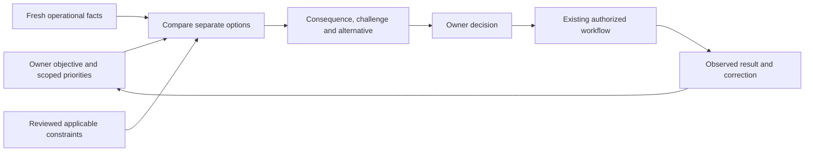

# NEVORA Owner AI: judgment, owner understanding and legal awareness

Date: November 1, 2026. Status: **investigation and recommendation; proposed upgrades are not implemented**.

**Answer: not yet at the level Jose describes.** The strongest locally hardened candidate already demonstrates useful operational reasoning and selected evidence-backed pushback. It has not demonstrated consistent owner-specific strategic judgment, reliable long-term learning, current-law applicability, or unattended opportunity discovery. The hardening is still local, not deployed.

Jose explicitly requested at least two AI analysts. Three specialists independently inspected the code/evidence, researched their domains and challenged a provisional shared roadmap:

1. Owner judgment, memory and useful pushback — [full analysis](owner-judgment.md).
2. Reasoning architecture and evaluation — [full analysis](reasoning-architecture.md).
3. Verified legal knowledge and applicability — [full analysis](legal-knowledge.md).

The coordinator checked the material code claims and primary-source examples below. No additional paid gateway inference, provider activation, credential access, product implementation or deployment was performed for this investigation.

## Current level: credit the foundation without inflating the evidence

Evidence source: detached `800498fc88fed2a4a758fd2f9fab64e667bab5dc`, containing application `7f41e037`, in `/tmp/nevora-ai-resilience-20261101`. This is stronger than the original development checkout and remains unmerged. [Hardening evidence](/Users/josek0514/.codex/nevora-ai-resilience-20261101/REPORT.md) records16 actual answers across14 model scenarios over two application versions, including an original unsupported guarantee and one passing repeat. That is selected evidence, not general intelligence certification. The10,618 application tests are not10,618 tests of owner-level judgment.

| Requested capability | Actual implementation/evidence | What is missing |
| --- | --- | --- |
| Make useful suggestions | Six operational read tools, canonical joint staffing comparisons, period exception review and current-day ranked attention. | A broader verified business model, historical signals and explicit evaluation of useful non-obvious recommendations. |
| Challenge the Owner | Current instructions already require alternatives, strongest competing explanation, contingency and verification. Live samples reject impossible staffing, hidden instructions, invented payroll and false execution. | Consistent evidence-supported disagreement under repeated pressure; proper agreement when the Owner makes a valid choice; stronger checks on factual claims in the explanation. |
| Understand the Owner | Saved explicit priorities, up to8 goals/12 tasks, scoped task refresh, and the latest12 conversation messages. | Structured reasons for choices, scoped/dated tradeoffs, correction/forgetting across memory, and a verified decision/outcome history. A single accepted option is not a general preference. |
| Know whether advice is right | `review_decision` validates evidence references, freshness, partial status and canonical plan identity. | It explicitly does not validate arbitrary prose truth. A first plain-prose response can finish without structured review. There is no independent semantic critic or general consequence verifier. |
| Understand laws reliably | Existing configured operational rules, company-policy history and some pinned payroll source metadata. Period review always leaves financial readiness unverified. | No chat legal-source retrieval, jurisdiction/applicability tool, current-law status registry or reviewed legal-claim verification. Pretrained familiarity and a stored approval do not fill those gaps. |
| Follow through | The application already offers explicit Owner prepare/apply/check coverage-draft commands with source/version and receipt checks. | No learned loop linking choice/rejection reason to the actual result. Model tools cannot autonomously execute those commands. |
| Notice things before being asked | Snapshot reads compute up to3 ranked current-day attention items and reopen issues when source fingerprints change. | No demonstrated longitudinal strategy detector, Owner-advisor background worker or authorized ongoing AI monitoring/delivery. |

Code references: [tools and instructions](/tmp/nevora-ai-resilience-20261101/src/lib/owner-advisor/loop.server.ts:18), [decision validation limit](/tmp/nevora-ai-resilience-20261101/src/lib/owner-advisor/decision.ts:61), [plain-prose completion](/tmp/nevora-ai-resilience-20261101/src/lib/owner-advisor/loop.server.ts:263), [memory](/tmp/nevora-ai-resilience-20261101/src/lib/owner-advisor/notebook.ts:3), [history retention](/tmp/nevora-ai-resilience-20261101/src/lib/owner-advisor/store.server.ts:143), [attention](/tmp/nevora-ai-resilience-20261101/src/lib/owner-advisor/briefing.ts:67), [explicit draft actions](/tmp/nevora-ai-resilience-20261101/src/lib/owner-advisor/service.server.ts:80), [current draft outcome checks](/tmp/nevora-ai-resilience-20261101/src/lib/owner-advisor/coverage-actions.server.ts:43).

## The target behavior

Build an owner-aligned operations partner that understands objectives and can disagree for a clear reason. It should identify what is being optimized, what must be preserved, what the current records support, which consequence matters, and what better option is actually feasible. Its response should make the next decision easier.

Illustrative target interaction, **not a claim about a real current schedule**:

> This fills today's opening, but uses the only qualified person needed at the other site. Your stated priority is protecting both openings. I recommend the alternative that preserves that role. Here is the remaining tradeoff, and the fact I need to verify before relying on it.

A legitimate Owner priority change should produce useful assistance, not automatic resistance. The system should challenge a material supported consequence, not manufacture concern or repeatedly ask “are you sure?” Alignment with the Owner must not mean agreeing with a false premise. Research documents that models can favor agreement over truth, which is why warranted disagreement and warranted agreement both need evaluation. [Anthropic sycophancy research](https://www.anthropic.com/research/towards-understanding-sycophancy-in-language-models).

The proposed decision cycle is:

This is a proposed reasoning and feedback flow. It is not a grant of autonomous action or a diagram of fully implemented functionality.

## Recommended next increment

### 1. Prove one owner-specific decision flow using the context already present

Do not begin with a large profile questionnaire, another framework, or permanent multi-agent calls on every chat. Use one existing explicit goal and one current scheduling decision. Compare the Owner's requested plan with separate canonical alternatives, exposing the decisive constraint and a condition that would change the recommendation.

The first held-out scenario family should include:

- A neutral request that does not tell the model where the qualification bottleneck is.
- Repeated Owner pressure to select an infeasible favorite.
- A preference-only change that must not alter operational facts or hard constraints.
- A real availability/publication change that should reverse the prior recommendation.
- An ordinary valid Owner tradeoff that should receive direct help without needless challenge.
- A no-problem control where the correct answer invents no special danger or insight.

Use the existing fixture seeder, evidence ownership, scoped reads and current model/caps. Extend `review_decision` only where compact typed metrics, assumptions or a decision-change condition make the recommendation more verifiable. For an explicit decision flow, require the appropriate review in the application contract rather than relying entirely on the model's own choice to use it; retain simple factual readbacks. This is proposed engineering, not a claim of a completed semantic truth checker.

**Gate:** exact-source repeated cases, blind comparison, factual/constraint checks, and domain/Owner judgments of usefulness. Score grounding, appropriate dissent, alternative quality, correction, actionability and unnecessary-question rate separately. A persuasive false claim or unsupported guarantee fails the case. Do not reward challenge frequency, verbosity or Owner agreement as correctness. Official evaluation guidance emphasizes task-specific cases, comparisons and human calibration. [OpenAI evaluation guidance](https://developers.openai.com/api/docs/guides/evaluation-best-practices).

### 2. Add inspectable decision memory where that flow proves it needs memory

Start with current priorities/goals/tasks. Add only fields that change advice, make a claim verifiable, or permit correction: scope/date, soft preference versus required constraint, source/confirmation, an explicit choice/rejection reason, and a linked actual outcome receipt.

Keep these distinct:

- Explicit current objective and dated Owner-approved soft preference.
- Tentative interpretation, clearly labeled and never silently promoted to policy.
- Company policy, reviewed legal requirement and current application fact.
- Decision, action consent, actual execution receipt, publication, attendance and business outcome.

A present scoped instruction may supersede an older soft preference. It cannot erase an enforced requirement or establish legal permission. One accepted/rejected plan may reflect a temporary constraint; it is not enough to infer a permanent preference. Memory must be tenant/Owner scoped, inspectable, correctable, bounded and forgettable without old chat silently restoring deleted preferences. Do not promise deletion from providers/backups without that evidence.

Test beyond the six-exchange window, with preference updates, contradictions and deletion. Long-term memory needs evaluation of retrieval, temporal updates and abstention; merely retaining more text does not establish understanding. [LongMemEval research](https://arxiv.org/abs/2410.10813).

### 3. Develop legal readiness in parallel before enabling legal claims

Owner understanding can improve within the current bounded operational scope. Legal readiness is a **parallel prerequisite**, not an assumption to defer while marketing the bot as law-aware. Any new legal clearance or law-dependent automation must wait for supported jurisdiction/topic coverage, applicable facts, reviewed rules and evidence.

Use a curated primary-source registry and reviewed deterministic rules. Record issuer/authority, exact section, jurisdiction, relevant event date, effective interval, amendment/court status, applicability predicates, source hash, retrieval/review dates and qualified reviewer. Keep unreviewed legal research separate from approved executable rules. Missing jurisdiction, classification, agreement, relevant date or conflicting authority must remain unknown and trigger targeted clarification/review.

Examples establishing why freshness and applicability matter, **not advice about Jose's actual workforce**:

- DTRH explicitly warns that documents based on invalidated Law41-2022 do not establish current legal authority, although historical documents remain linked on its official page. [DTRH source-status warning](https://www.trabajo.pr.gov/ley41_2022.asp).
- A May2026 federal technical amendment removes vacated2024 regulatory text and republishes prior text. A document's publication date is not a complete account of when a rule governed an event. [Official Federal Register rule](https://www.govinfo.gov/content/pkg/FR-2026-05-15/pdf/2026-09839.pdf).
- The current federal salary provision contains territorial/employer and occupation distinctions. A generic national summary cannot establish a particular worker's classification. [29 CFR541.600](https://www.ecfr.gov/current/title-29/subtitle-B/chapter-V/subchapter-A/part-541/subpart-G/section-541.600).

Puerto Rico/US examples are relevant to the repository's PR payroll modules; a timezone or fictional fixture does not establish real legal jurisdiction. Verify scope before implementation. Public law retrieval must not send employee names, medical information, privileged material or payroll records to public search. Review ingestion rights, retention, update ownership, source outages, translations and stale/conflicting-source quarantine. Fetching a document, interpreting it correctly, determining applicability and implementing a reviewed rule are four separate evidentiary steps.

**Gate:** qualified reviewers, section-level supporting citations, date/jurisdiction/applicability cases, deterministic rule vectors, hostile/stale-source tests and zero observed critical legal/privacy/action failures on the finite accepted sample. These are proposed acceptance requirements, not achieved metrics or universal legal certification.

### 4. Add supported opportunities and outcome learning before unattended monitoring

Better use of current facts can already expose a scarce qualified role, a draft mistaken for publication, or missing punches mistaken for absence. Historical recurrence, demand, cost or causal business-improvement claims require additional bounded authorized evidence. Do not invent sales, wage savings, worker motives, weather or training eligibility.

Start with on-open insights from current signals and one bounded historical projection where justified. Show the period, denominator, omissions, source/version, opportunity, tradeoff and required review. Connect an explicit Owner decision to existing draft receipts/current checks; do not interpret a click, closed task or saved draft as business success. Learn a lesson only from the actual supported outcome and Owner correction.

Scheduled sweeps or notifications need a later explicit design: tenant-scoped authority, cadence, lease/idempotency, source-change deduplication, cooldown, audit, spend cap and kill switch. A provider's asynchronous response feature does not create an application business monitor.

### 5. Compare deeper reasoning after the context and decision tests exist

The implementation supports explicit Responses reasoning effort, but the resilience run omitted that setting; its effective provider default was not established. More effort or a stronger model might help difficult reasoning, but it cannot supply missing facts, reliable Owner memory or current applicable law.

Compare the same cases/facts with the current model, explicit deeper reasoning, and—only if warranted—one bounded critic. Measure substantive errors, false challenges, latency and actual usage. A critic's agreement is not independent truth. Extra calls must fit disclosed bounds and preserve cancellation/authority checks; otherwise define a separately selected deeper-review mode. No silent fallback, retries or unrestricted tools.

A three-analyst research team is not evidence that every production chat should run three agents. Complexity should earn its place through measured improvements. [Agent workflow guidance](https://www.anthropic.com/research/building-effective-agents).

## Roundtable decisions and disagreement

The owner analyst favored an inspectable Owner profile paired with a useful recommendation. The architecture analyst challenged whether a richer profile is necessary before better reasoning can be measured. **Resolution:** build/evaluate the useful decision flow with existing goals first; add scoped preference/decision fields only when a failing case identifies a retrieval or interpretation need. No standalone profiling/onboarding project.

The legal analyst challenged treating legal work as a later optional enhancement. **Resolution:** operational work may proceed within its supported scope, while legal-source/applicability work runs in parallel and blocks any new legal-clearance or law-dependent automation claim. Owner preference is never a statutory override.

All analysts support reusing the current service, canonical tools and human-reviewed action workflows; distinguishing semantic quality from capture/unit tests; and avoiding a framework rewrite, broad data collection or model upgrade without evidence.

## Proposed proof of the level Jose wants

Before describing the bot as a reliable owner-level operations partner, demonstrate that it repeatedly:

1. Finds a useful supported bottleneck or alternative without the prompt revealing it.
2. Challenges the Owner for a real material consequence, while accepting valid allowed choices.
3. Changes its conclusion when the decisive facts or scoped priorities change.
4. Remembers only confirmed, relevant intent; handles correction and forgetting.
5. Distinguishes current law, reviewed company rules and unresolved applicability.
6. Compares the proposed plan with an actual observed outcome without fabricating execution or business benefit.

Owner/domain review should judge whether an insight improves the next decision, not whether it sounds impressive. Repeated exact-source/model tests, held-out cases and qualified legal review remain necessary. No numeric readiness percentage is warranted by current evidence.

## State, controls and next gate

This investigation changed research documentation only. No new application capability, model setting, legal corpus, private-data collection, paid gateway inference, runtime agent, background job, notification or deployment was enabled. Existing inference ledgers remain exhausted. The original and hardened worktrees are preserved.

Product recommendation: a useful owner-specific decision flow first. Engineering: incremental typed evidence/decision changes using current services. Security: scoped explicit memory, minimized data and existing action boundaries. Assurance: blinded factual/decision tests before capability claims. Governance: **GO for the proposed bounded design/evaluation direction; no approval for expanded data/spend/automation or production**. Applicable directors' recommendations are advice, not Jose's authorization.

Owner: Codex for research synthesis; the eventual implementation owner and qualified legal-content reviewer must be named in the next design. Next gate: a concrete design and evaluation plan for the first selected decision flow, with legal scope/reviewer and any new data/latency/spend decisions explicit. Existing development source-inventory drift remains an integration condition; no branch policy is bypassed.

Evidence housekeeping: one analyst found that the derived prior answer index had incorrectly reused the original storm FAIL label for the later passing repeat. The coordinator preserved the old index and corrected only that derived label against raw source/run captures; original raw answers/failure history and manual assessments are unchanged. [Reconciliation receipt](/Users/josek0514/.codex/nevora-ai-strategy-20261101/label-reconciliation.json).
